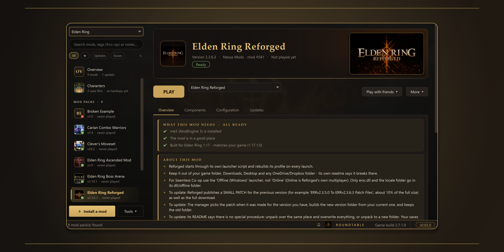
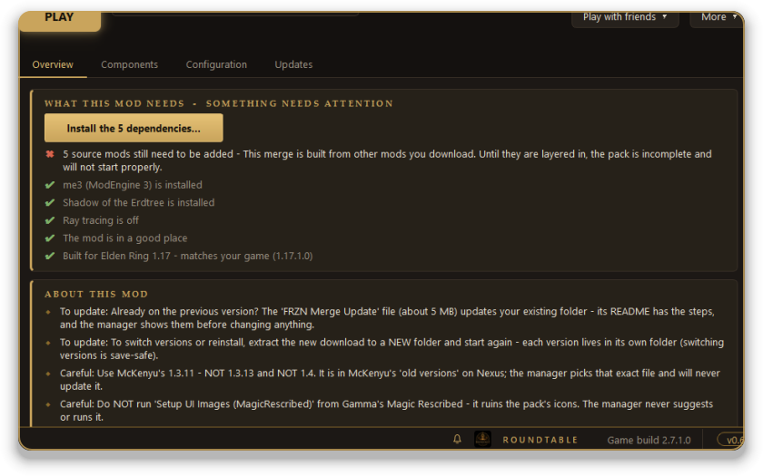
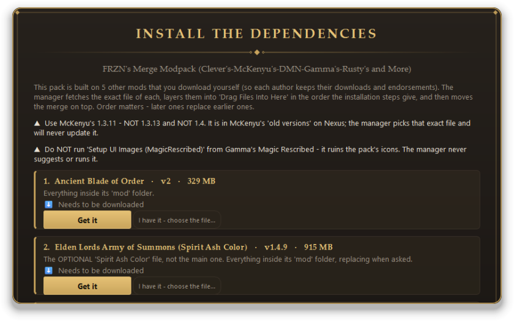
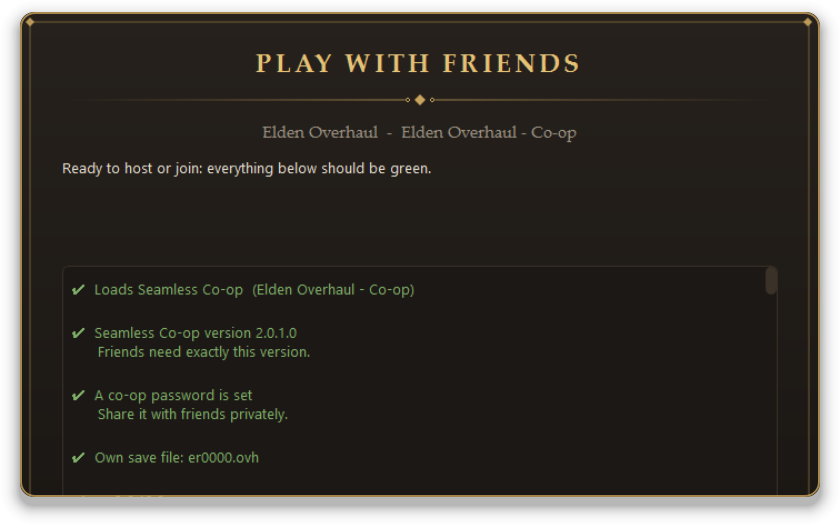
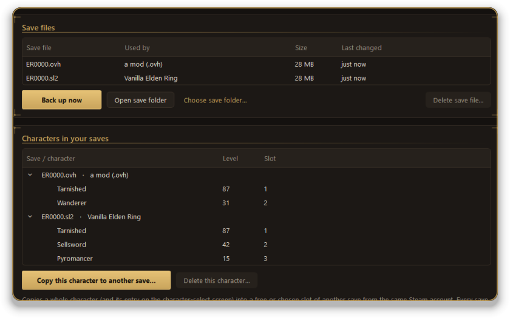
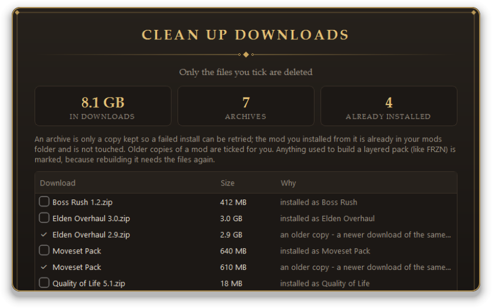
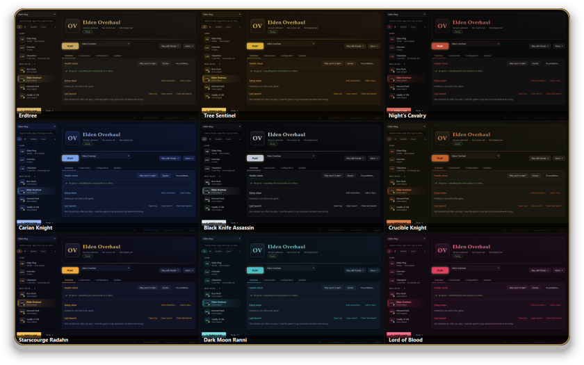

  

  

  
  
  

  <a href="docs/GUIDE.md"><b>Step-by-step guide</b></a> &nbsp;·&nbsp;
  <a href="docs/FEATURES.md"><b>Everything it can do</b></a> &nbsp;·&nbsp;
  <a href="https://github.com/Nexus-Primes/Roundtable/issues"><b>Report a problem</b></a>

 

## Why Roundtable

<table>
  <tr>
    <td width="25%" valign="top"><h4>One PLAY button</h4>Pick a mod and press it. Roundtable checks the mod first and tells you in plain words if something will go wrong.</td>
    <td width="25%" valign="top"><h4>Big packs, set up for you</h4>It knows what the major overhauls need, and layers in the other mods a pack is built from.</td>
    <td width="25%" valign="top"><h4>Co-op, sorted</h4>Matching versions, passwords and save files for you and your friends, in one place.</td>
    <td width="25%" valign="top"><h4>Saves stay safe</h4>Automatic backups, and nothing is deleted without asking. Most changes can be undone.</td>
  </tr>
</table>

 

## A closer look

<table>
  <tr>
    <td width="50%" valign="top" align="center"> <b>Knows what each mod needs</b> A checklist for your PC, with a button for each missing piece.</td>
    <td width="50%" valign="top" align="center"> <b>Packs built from other mods</b> The exact files, in the right order, layered in for you.</td>
  </tr>
  <tr>
    <td width="50%" valign="top" align="center"> <b>Play with friends</b> A green checklist and a ready-to-send invite.</td>
    <td width="50%" valign="top" align="center"> <b>Characters and saves</b> See every character, back them up, copy them between saves.</td>
  </tr>
  <tr>
    <td width="50%" valign="top" align="center"> <b>Tidy disk space</b> See which old downloads can go. Nothing is removed until you tick it.</td>
    <td width="50%" valign="top" align="center"> <b>Make it yours</b> Twelve themes, and an animation level you can turn down.</td>
  </tr>
</table>

 

## Start in three steps

<table>
  <tr>
    <td width="8%" align="center"><h2>1</h2></td>
    <td><b>Download</b> the file ending in <code>-windows.zip</code> from the <a href="https://github.com/Nexus-Primes/Roundtable/releases/latest">latest release</a>.</td>
  </tr>
  <tr>
    <td align="center"><h2>2</h2></td>
    <td><b>Unzip it</b> into a simple folder such as <code>C:\Tools\Roundtable</code> - not Downloads, Desktop or OneDrive.</td>
  </tr>
  <tr>
    <td align="center"><h2>3</h2></td>
    <td><b>Open <code>Roundtable.exe</code>.</b> If Windows says <i>"Windows protected your PC"</i>, click <b>More info</b>, then <b>Run anyway</b>. Roundtable then tells you what's missing and offers to install it.</td>
  </tr>
</table>

> New to mods? The [guide](docs/GUIDE.md) walks through your first mod, co-op, and what to do when something goes wrong.

 

## Questions

<b>Do I need Nexus Premium?</b>

 
No. A free account works: turn on <i>Nexus download buttons</i> in Settings and the <i>Mod Manager Download</i> button on a mod page sends the file here. Premium adds fully automatic downloads.

<b>Can I get banned?</b>

 
Modded <b>online</b> play can get an account banned. Roundtable never turns online mode on and warns you if a profile has it. Play offline, or use Seamless Co-op, which is its own network.

<b>The game started but my mod isn't there</b>

 
On the mod's page press <b>Why won't it start?</b>, or open <b>Tools -> PC check</b>. They list what's wrong in plain words and fix the common causes. The <a href="docs/GUIDE.md">guide</a> has more.

<b>Is it safe? What does it send?</b>

 
Your Nexus key stays on your PC, encrypted with Windows' own protection, and is only sent to nexusmods.com. Updates are <b>signed</b>, and Roundtable refuses one whose signature doesn't check out. Mods are always downloaded from the author's own page - this project never hosts or shares mod files.

 

---

An unofficial fan tool, not affiliated with FromSoftware, Bandai Namco, Nexus Mods, or the authors of me3 or Seamless Co-op - please support the mod authors whose work you install. 
Thanks to me3 / ModEngine 3 (garyttierney), Seamless Co-op (LukeYui) and ER-Save-Editor (ClayAmore). <i>Elden Ring</i> is a trademark of FromSoftware / Bandai Namco.

