
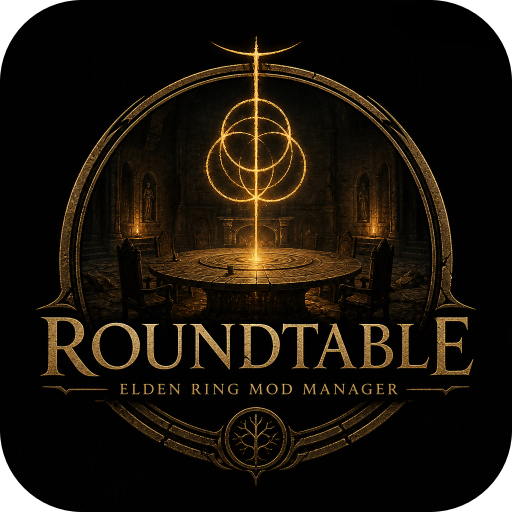

# Roundtable

**A friendly way to install, organise and play Elden Ring mods - and to play co-op with your friends - without digging through folders.**

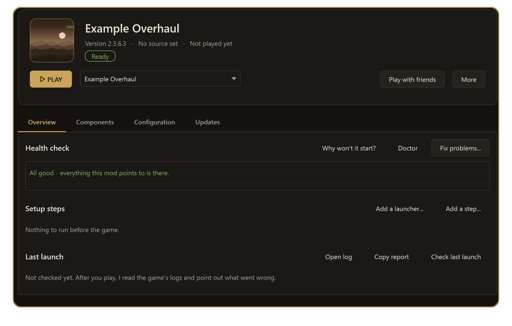

If you've ever unzipped a mod, wondered which folder it goes in, and then watched the game start without it - this is for you. You pick a mod, press **PLAY**, and the manager takes care of the awkward parts: putting files in the right place, checking for problems *before* the game starts, keeping your saves safe, and keeping everything up to date.

> **Windows only.** Needs Elden Ring on Steam. You do **not** need to know anything about programming.

[**Download the latest version**](https://github.com/Nexus-Primes/Roundtable/releases/latest)

---

## What it does for you

| You want to... | The manager... |
|---|---|
| **Install a mod** | Searches Nexus Mods or opens the file you downloaded, shows you what's inside, installs it, and fixes the usual profile mistakes automatically. |
| **Play it** | One **PLAY** button. It looks the mod over first and tells you in plain words if something will go wrong - then watches the game start and tells you if your mod didn't load. |
| **Fix what breaks** | Explains why a mod won't start, repairs what it can (with undo), and can find which DLL is crashing the game. |
| **Set up big mod packs** | Knows what the major overhauls need, and layers in the other mods a pack like FRZN's Merge Modpack is built from. |
| **Play with friends** | Checks your co-op setup, helps everyone use the same password and versions, and writes you an invite to send. |
| **Keep your characters safe** | Backs up your saves automatically, can keep a second copy somewhere else, and asks twice before anything involving a save is deleted. |
| **Stay up to date** | Tells you when a mod, me3 or the manager itself has a new version - and updates without you leaving the app. |
| **Tidy up** | Shows which old downloads can go, and clears them only when you say so. |
| **Undo mistakes** | Almost everything it does is backed up and can be undone. |

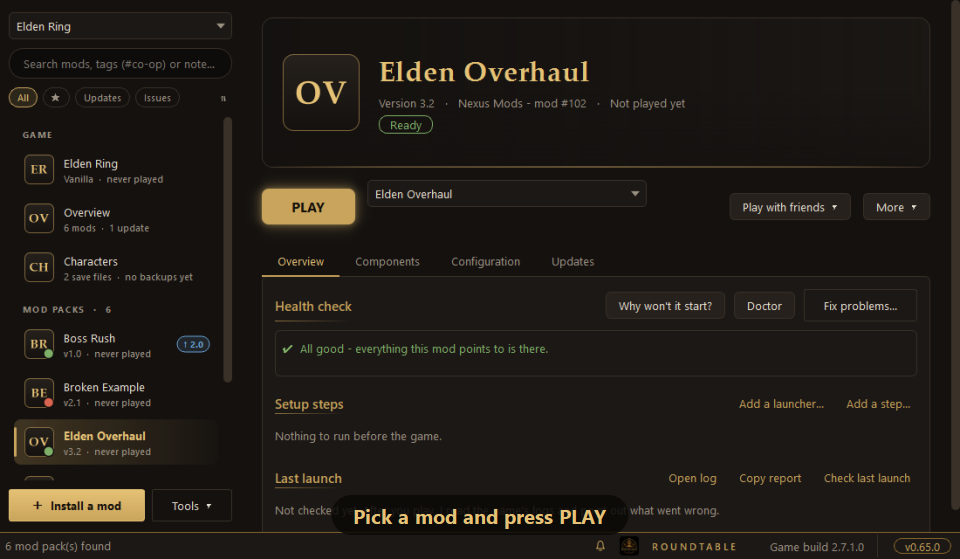

---

## Get started (about 5 minutes)

### 1. Download

Open the **[Releases page](https://github.com/Nexus-Primes/Roundtable/releases/latest)** and download the file ending in **`-windows.zip`** (it's listed under *Assets*).

### 2. Unzip it somewhere permanent

Right-click the zip and choose **Extract All...** into a simple folder such as `C:\Tools\Roundtable`.

> **Please don't** run it from inside the zip, from your *Downloads* or *Desktop*, from a **OneDrive** folder, or from inside the Elden Ring folder. Windows and OneDrive can lock or hide files there, which causes confusing errors.

### 3. Open `Roundtable.exe`

The first time, Windows may say **"Windows protected your PC"**. That's because the program isn't signed with a paid certificate. Click **More info**, then **Run anyway**.

### 4. Let it set itself up

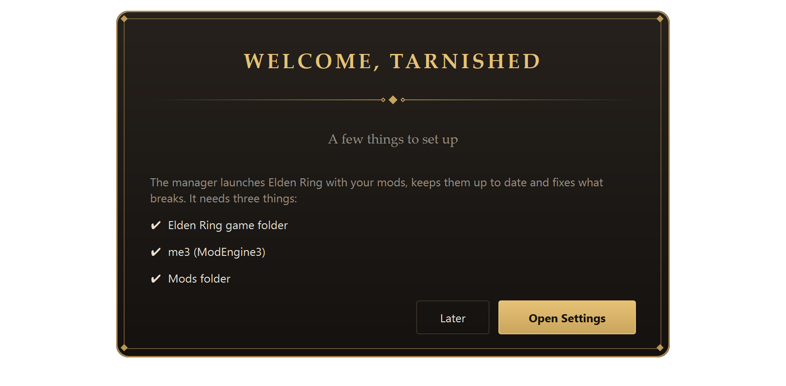

On the first start the manager tells you what's missing. The things it needs are:

- **me3** (ModEngine 3) - the small program that actually loads mods into the game.
  In the manager choose **Tools → This program → Install or update me3...** and follow the installer's window like any other installer. When it closes, the manager finds it by itself.
- **The Microsoft Visual C++ runtime** - almost every DLL mod needs it. If it's missing, the same window offers to install it for you.

Then open **Settings** and make sure the **Mods folder** is the folder where your mods will live (an empty folder is fine - the manager will fill it).

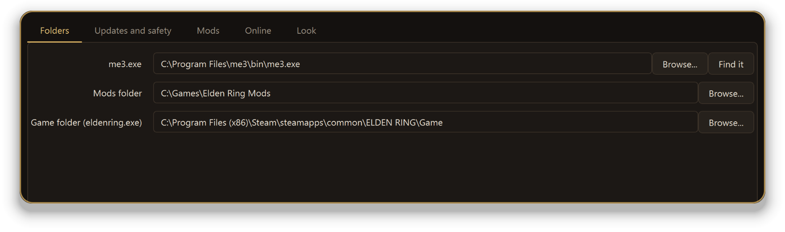

### 5. (Optional but handy) Add your Nexus Mods key

A free Nexus Mods account lets the manager search for mods, show their pictures, and check for updates. To connect it you give the manager your **Personal API Key** - a long password-like code that Nexus makes for you. Most people have never seen it, so here is exactly where it is:

1. Go to [nexusmods.com](https://www.nexusmods.com) and **log in**. (No account yet? Sign-up is free.)
2. Click your **profile picture** in the top-right corner of the page.
3. Choose **Site preferences** (on some versions of the site the menu says *Account settings* or *Preferences*).
4. In the menu on the left, click **API Keys** (older versions call this tab **API**).
5. Scroll to the very bottom of that page to **Personal API Key**. If a key isn't shown yet, press the button there to **request / generate** one.
6. **Copy** the whole key - it is a long mix of letters and numbers, often ending in `==`.
7. In Roundtable open **Settings → Online**, paste it into **Nexus API key**, and press **Test key**. It tells you the account it belongs to and whether you have Premium.

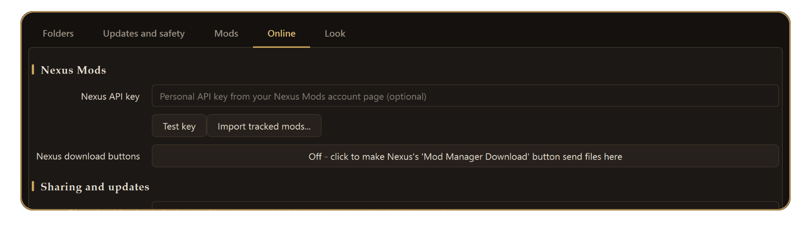

- **Treat it like a password.** Don't post it in screenshots, Discord or issue reports. The manager stores it encrypted on your PC and only ever sends it to nexusmods.com. If it ever leaks, request a new one on the same Nexus page and the old one stops working.
- **Free or Premium?** Both work. With a free account Roundtable opens the mod's Nexus page and you press Nexus's *Mod Manager Download* button (turn on **Nexus download buttons** in the same Settings tab); Premium accounts download fully automatically.
- **Can't find it?** Nexus occasionally renames menus. Look for anything called *API* in your profile or site preferences, or search "Personal API Key" in Nexus's help pages.

---

## Installing and playing your first mod

1. Press **＋ Install a mod** (bottom-left).
2. Either **search Nexus** and pick a mod, or choose a `.zip`, `.7z` or `.rar` you already downloaded (or just drag it onto the window).
3. Look over what the manager found, press **Install**. It repairs common problems for you and says what it did.
4. Click the mod in the list on the left and press **PLAY**.

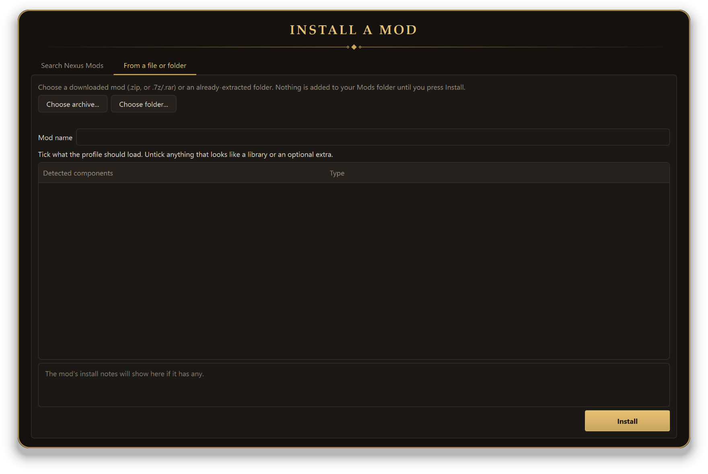

**Tip - the "Mod Manager Download" button.** In **Settings**, turn on **Nexus download buttons**. After that, the *Mod Manager Download* button on a Nexus mod page sends the file straight here. This works with free Nexus accounts, too.

**Some mods are "add-ons"** (small DLL files like free-camera or UI tweaks). When you install one, the manager offers to add it to the mods you already play instead of making it a separate mod.

### Some mods need one more step

If a mod's author says something must be run once before the first launch - an install `.bat`, a *Setup UI images* shortcut, a zip of DLLs meant for the game folder - the manager offers to do it right after the install. **Nothing runs until you press a button.** Each item opens in its own window, the manager waits for it to finish, checks that it worked, and lets you retry if it didn't.

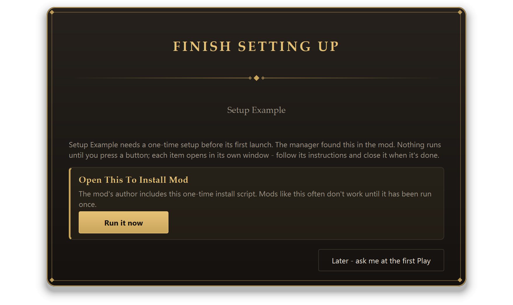

### Packs built from other mods

Some packs, like **FRZN's Merge Modpack**, are made by layering several other mods you download yourself. After you install one, the **Install the dependencies** window opens (or press the button on the pack's *What this mod needs* card):

1. Press **Get it** on each mod. A Premium Nexus account downloads it for you; a free account opens that file's Nexus page and the *Mod Manager Download* button there hands the file back. Already downloaded it? The manager spots it in your Downloads folder.
2. When all are ready, press **Build it**. Each is unpacked and layered in the order the author's instructions give, using the right old version where needed (FRZN needs McKenyu's 1.3.11, not the newest).

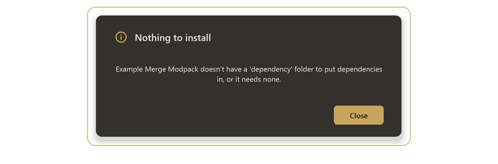

If a build stops, press **Build it** again - finished steps are remembered. When the pack later publishes an update file, apply it from the pack's **Updates** tab (*Update from file...*); the manager shows the author's steps first, then offers to move the update's files on top of the layers, with a backup of everything it replaces.

---

## A mod's page

Click a mod in the list. The top shows its version, where it's published and whether it's ready. Under the **PLAY** button are four tabs:

- **Overview** - the health check, setup steps, and what happened on the last launch. On a known mod it also shows **What this mod needs**: a checklist for your PC (me3, the DLC, ray tracing, the game version) with a button next to anything that's missing, plus the author's own warnings. If the mod hasn't been updated since before your last game patch, it says so - the most common cause of a crash after a patch.
- **Components** - every DLL and asset folder the mod loads. Tick to switch one on, untick to switch it off; drag or use the arrows to change the load order. **Loadouts** saves named combinations, and **Check conflicts** finds two mods replacing the same files.
- **Configuration** - the mod's settings files as a tidy form (or raw text). Only the value you change is rewritten, so the file's comments and layout stay. Edited files are backed up first and the author's original is always kept.
- **Updates** - see [Keeping up to date](#keeping-up-to-date).

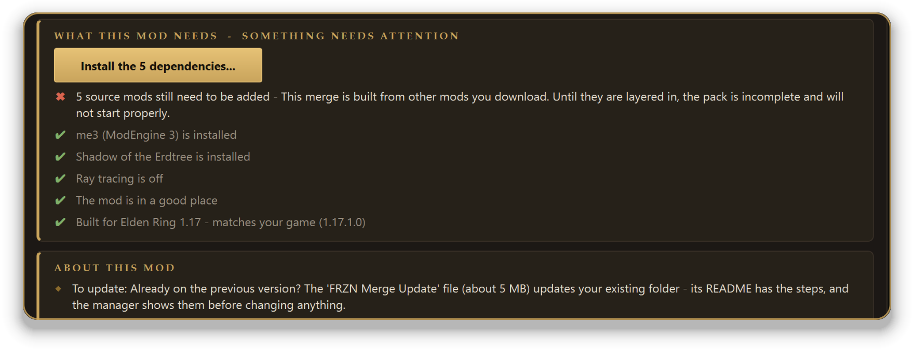

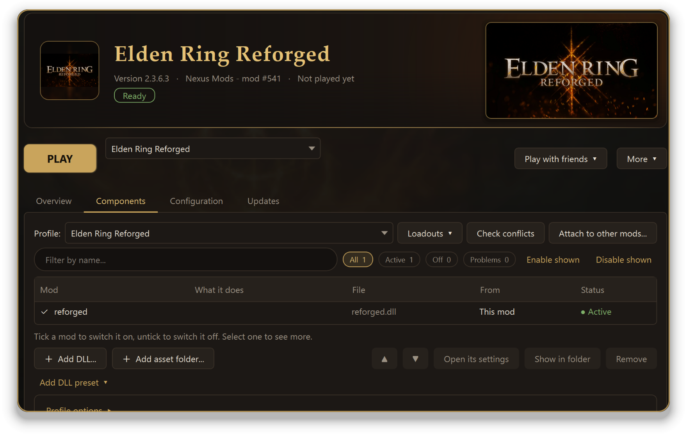

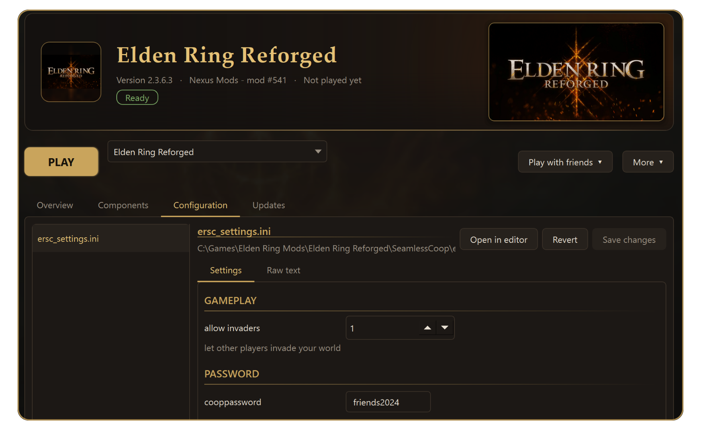

### Pressing PLAY

Before the game starts, the manager looks the profile over and, if something is likely to go wrong, tells you in plain words and lets you decide.

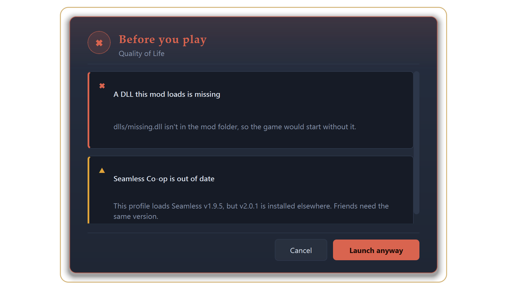

While the game runs, the button shows **RUNNING** (and blocks a second launch) and playtime is tracked per mod. A minute after the game starts the manager reads me3's log and tells you at once if it started *without* your mod, and why. Vanilla Elden Ring starts through Steam with Easy Anti-Cheat; mods start through me3.

---

## When something goes wrong

Start with the buttons on the mod's **Overview** tab:

- **Why won't it start?** collects every clue (including files Windows Defender removed) and lists the likely cause first.
- **Doctor** checks your whole PC: game folder, me3, the Visual C++ runtime, Steam, OneDrive and disk space.
- **Fix problems...** scans the mod and offers repairs you tick one by one - re-linking moved files, copying in a missing shared DLL, switching off files that can't work. Everything is backed up and **Undo last fix** reverses it.
- **Find the cause** (for a crashing game) switches half of a mod's DLLs and folders off, asks you whether it still crashes, and narrows it down to the one that matters. If Windows has recorded which DLL crashed, the manager offers to switch that one off for you.

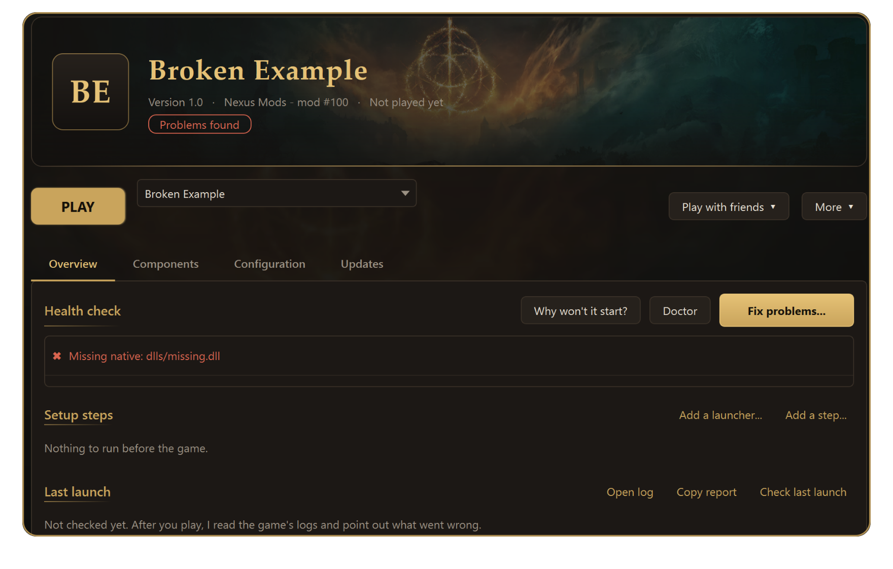

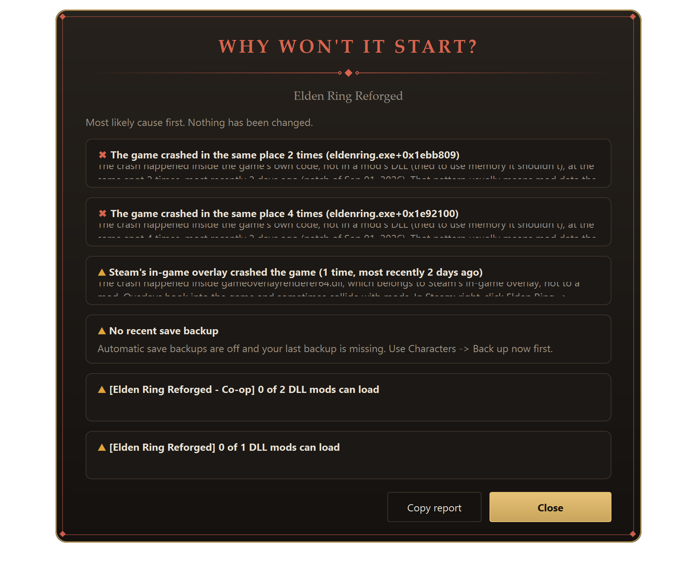

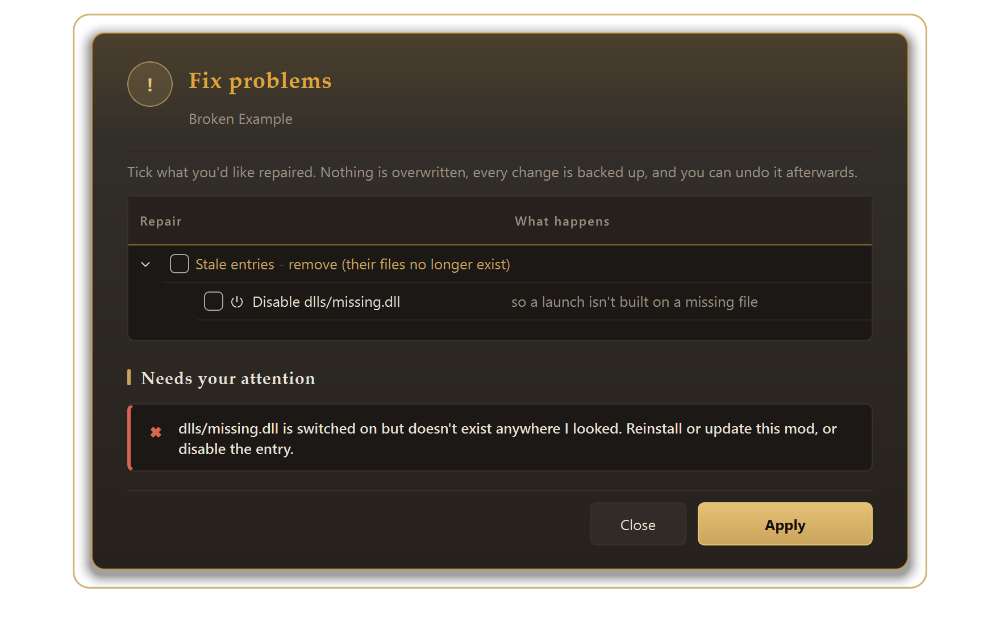

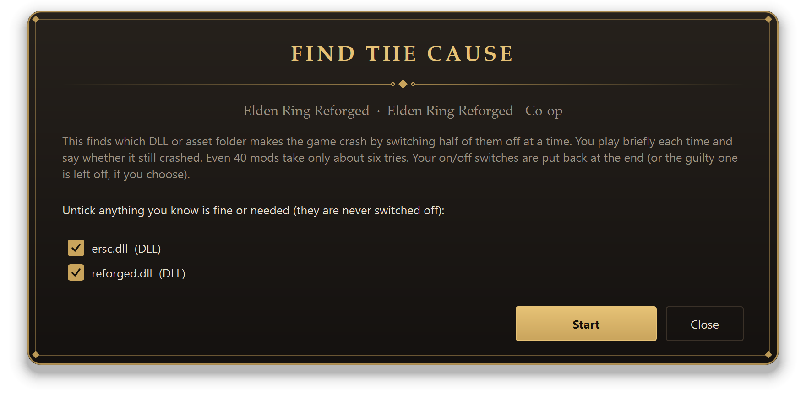

**Copy report** gathers everything for a help request, with personal paths removed.

---

## Playing co-op with friends (Seamless Co-op)

Co-op only works when **everyone has the same mod versions, the same Seamless Co-op version, and the same password.** The manager makes that much less painful.

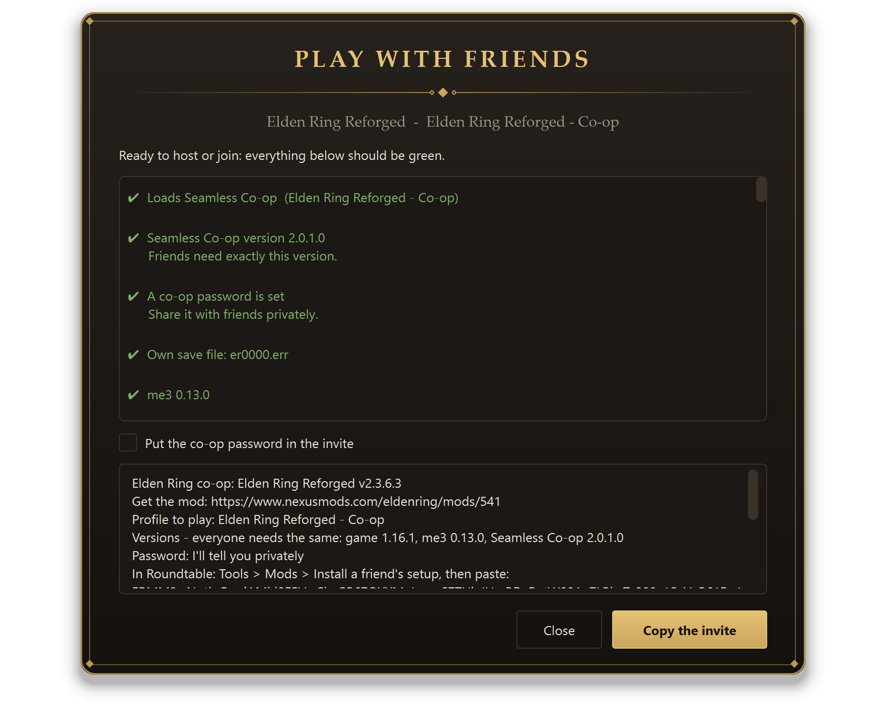

- **Play with friends → Ready to play?** on a mod's page shows a checklist (Seamless version, password, your own save file, me3, game version) and a ready-to-send **invite** you can copy or post to Discord.
- **Add Seamless Co-op...** (on the mod's *Components* tab) puts Seamless into a mod for you, with its own save file so characters never get mixed up.
- Friends who have the manager can use **Tools → Mods → Install a friend's setup** - paste the setup (or a link to it) you made with **Share my setup** and it downloads the same mod versions, adds your add-on DLLs, sets up Seamless Co-op, and switches the same DLLs on in the same order. The co-op password and settings files are only included if you tick them.
  Before it changes anything, the friend sees a plain list of what will change and can go back; **Tools → Backups and undo → Undo last friend's setup** reverses it. Tip: put your setup in a GitHub gist and send friends the link - when you change your setup you update the gist, and they just open *Install a friend's setup* and press *Read it* again.
- **Play with friends → Compare setups** finds out exactly *why* two people can't connect.
- **Friends' setups** (Tools → Mods) keeps your friends' setup links in one list and shows at a glance whether you match each of them, with a **Room** view that lines everyone up side by side.

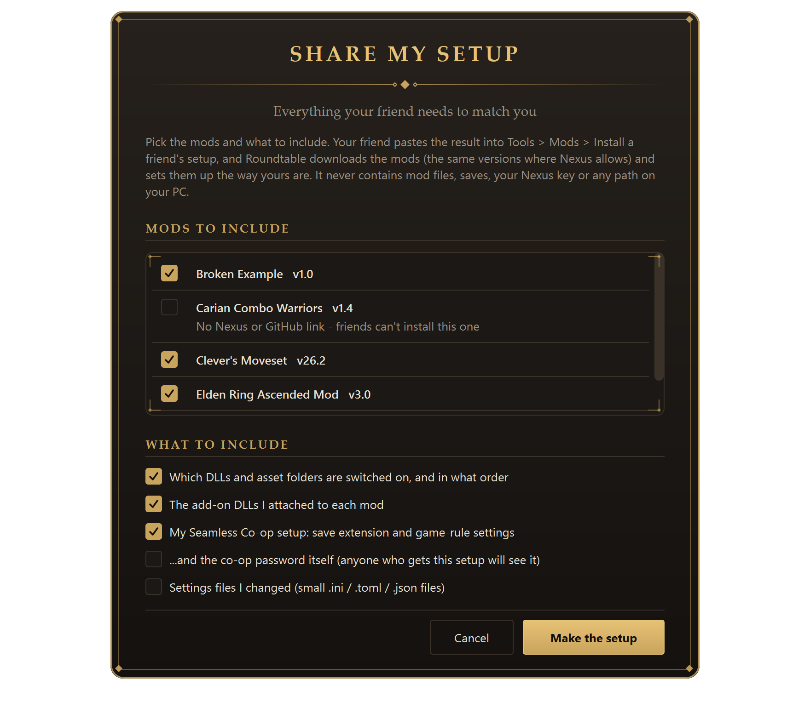

### Your DLL preset, without duplicates

Save the DLL mods you use everywhere as a **DLL preset** (*Tools → Mods → DLL presets...*) and add it to any mod in one click. If a mod already has one of the same DLLs, the manager asks which copy to use - the mod's or yours - so nothing is ever loaded twice, and undoing it puts everything back.

### All your passwords and save files in one place

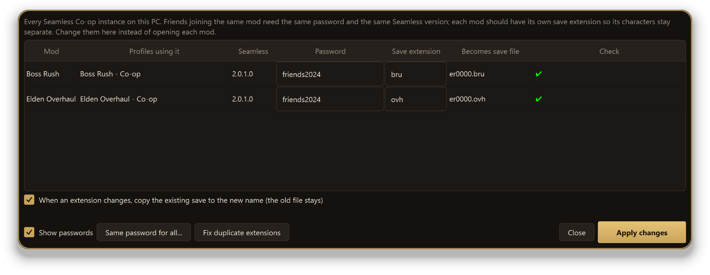

**Tools → Seamless Co-op → Passwords and save files...** lists every co-op setup on your PC. Change passwords and save-file endings there (even set one password for everything), see which ones clash, and let the manager give each mod its own. If you change a save ending, it can copy your existing save across so your character comes with you.

### Seamless versions

Seamless refuses to start when its DLL is out of date. **Tools → Seamless Co-op → Seamless versions...** lists every copy on your PC and updates the older ones from the newest.

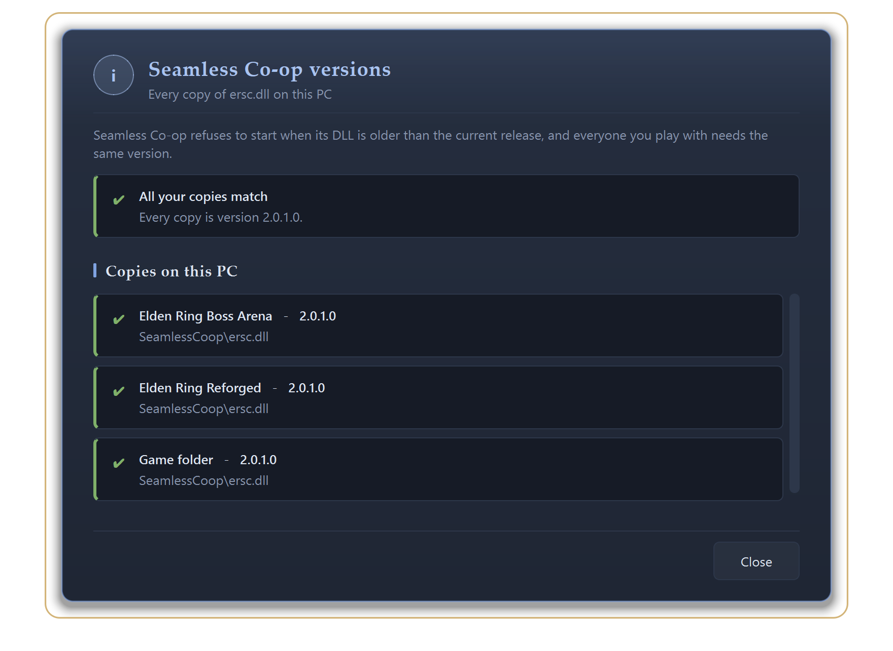

---

## Your saves are protected

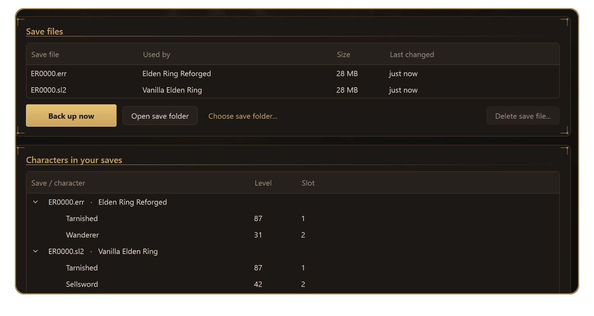

The **Characters** page (top of the list) shows every save file and the characters inside it.

- **Backups happen automatically** before you launch, and before anything that touches a save. Unchanged saves share space, so keeping many costs little. **Back up now** takes one on demand, and the manager can also back up every few minutes while the game runs (*Settings*).
- **A second copy** can be sent to another drive, a NAS or a cloud-synced folder (*Backups → Second copy*).
- **Copy a character** from one save to another - for example from your normal game into your co-op save - with *Copy this character to another save...*. It only works between saves from the same Steam account, checks everything first, and makes a backup first.
- **Deleting is guarded.** Deleting a character or a whole save file makes a protected backup first, shows you exactly what will go, and makes you **type the name** before it does anything. Deleted save files are moved aside, not erased, and *Backups → Restore* brings them back.
- Please **play offline** with copied or edited characters. Online play with mods can get an account banned, and the manager never turns online mode on by itself.

---

## Keeping up to date

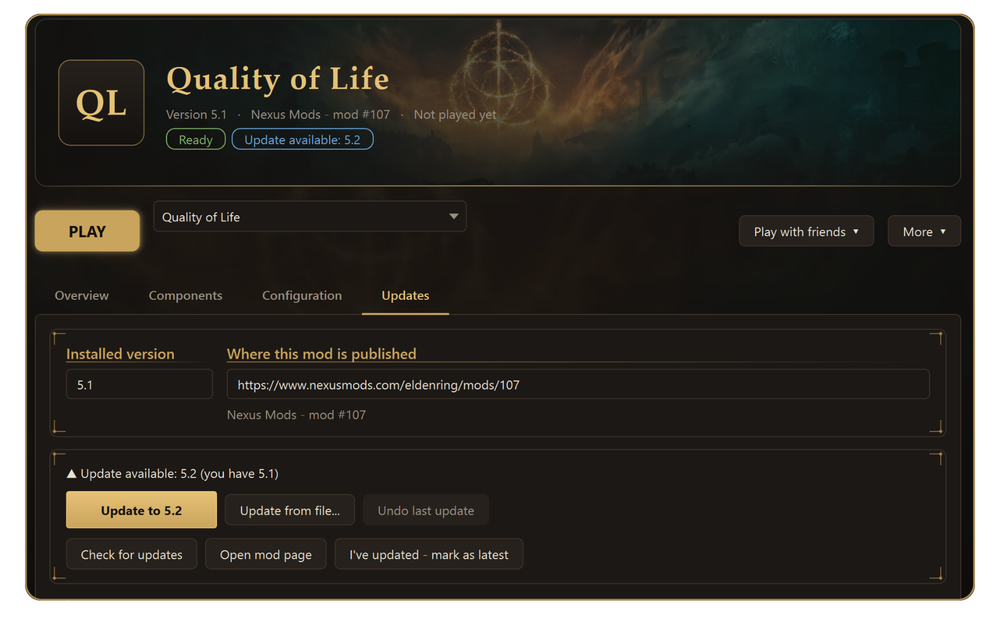

- **Mods:** open a mod's **Updates** tab, or use *Tools → Check all for updates*. A badge appears in the list when a new version is out, and *Update to ...* downloads and applies it safely. *Undo last update* reverses it.
- **Patches are found and applied safely.** Some mods publish a small patch for the previous version as well as the full download. The manager tells them apart and offers the patch only when it was made for exactly the version you have.
- **The author's instructions are read.** If an update comes with a README that explains how to apply it, the manager shows those steps before changing anything. *Update from file...* applies a download you made yourself.
- **me3:** the manager checks about once a day and tells you when a newer one is out - *Tools → This program → Update me3...*.
- **The game:** the manager remembers your `eldenring.exe` version. When a patch changes it you're told, and mods whose logs show they don't support it are marked.
- **The manager itself:** when a new version is published, a banner appears in the sidebar. Click it and the manager downloads the update, checks its signature, restarts, and keeps all your settings and backups. If a new version ever misbehaves, **Tools → This program → Go back to an earlier version...** returns to the one you had before.

### Finding things

Press **Ctrl+K** and type a few letters to jump to any mod or tool; **F1** lists the keyboard shortcuts. **All tools...** lists every tool and setting on tabs, with a search box.

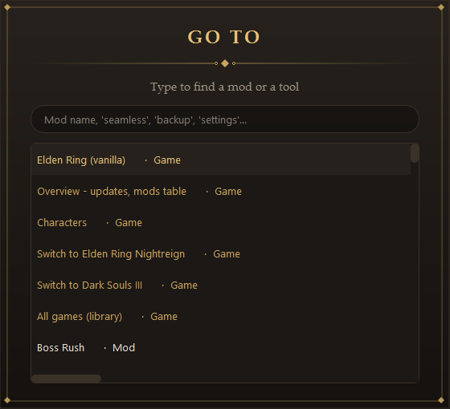

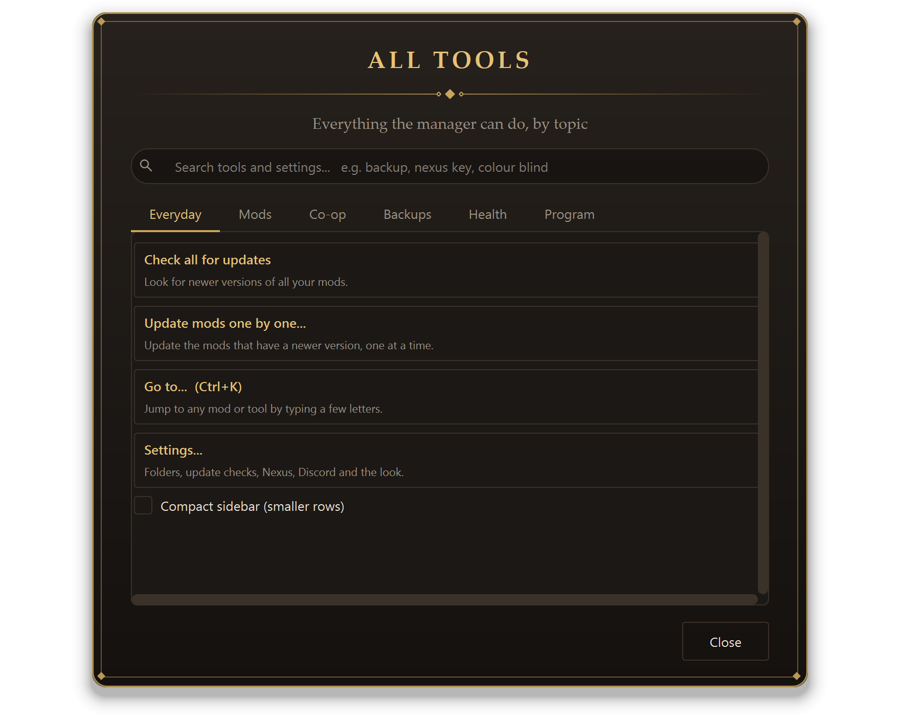

Everything else lives in the **Tools** menu, grouped by topic:

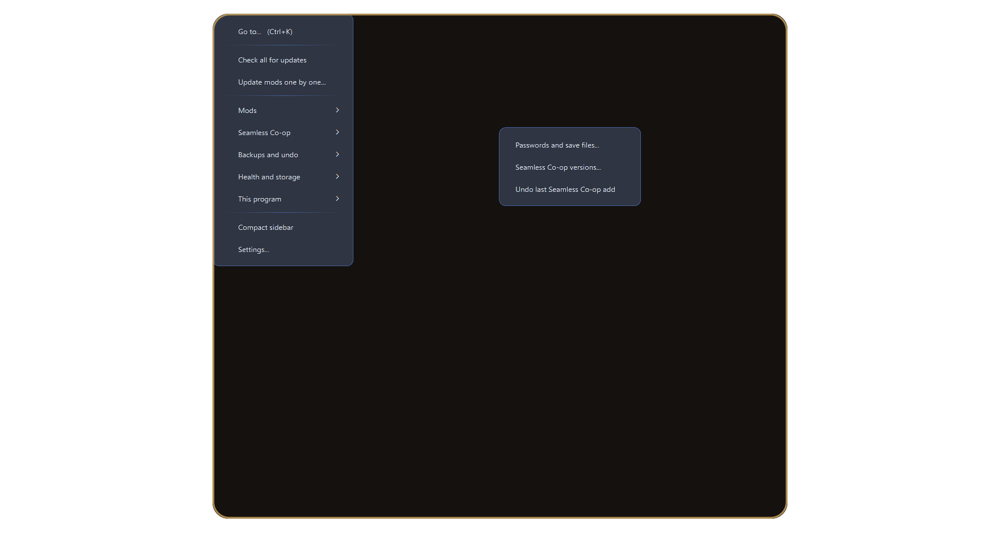

### Tidying up

*Tools → Storage... → Choose downloads to delete...* lists every downloaded archive with why it can go: the mod is already installed, it's an older copy, or it was used to build a layered pack (kept unless you tick it, because a rebuild needs it again). Older copies are ticked for you, and **nothing is deleted until you confirm**. Installed mods are never touched. In *Settings → Updates and safety* you can also keep only the newest few archives per mod and trim old backups automatically - both are off by default.

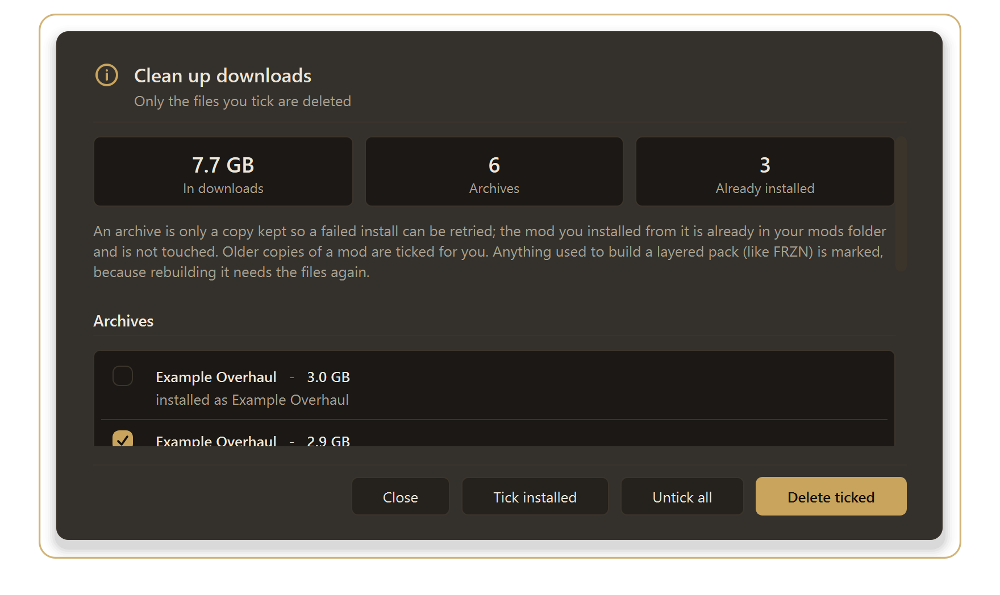

### More than one game

The box at the top of the sidebar switches between **Elden Ring**, **Elden Ring Nightreign** and **Dark Souls III** - each keeps its own mods folder, profiles and save backups, and the manager launches the right game through me3. **All games...** shows every supported game as a card; Dark Souls 1 and 2 get Play and save backups, and **Bloodborne** (the community Windows port) gets Play, a health check, every launcher setting and a controller check, without touching the game files.

---

## Make it yours

Open **Tools → This program → Appearance...** and pick a theme. Each one is a complete colour scheme named after something from the Lands Between:

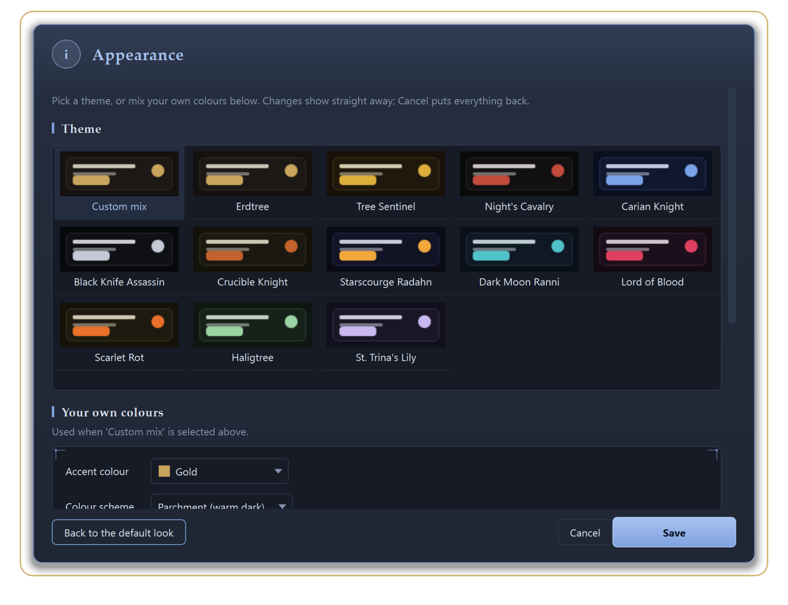

Click a theme and the whole manager changes straight away - **Cancel** puts everything back, **Save** keeps it.

<b>See every theme at full size</b>

**Erdtree**

[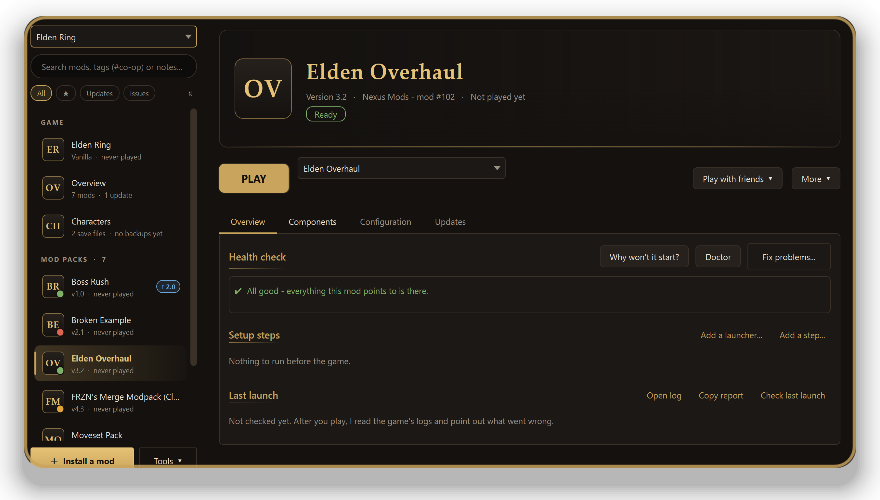](docs/images/theme-erdtree-full.png)

**Tree Sentinel**

[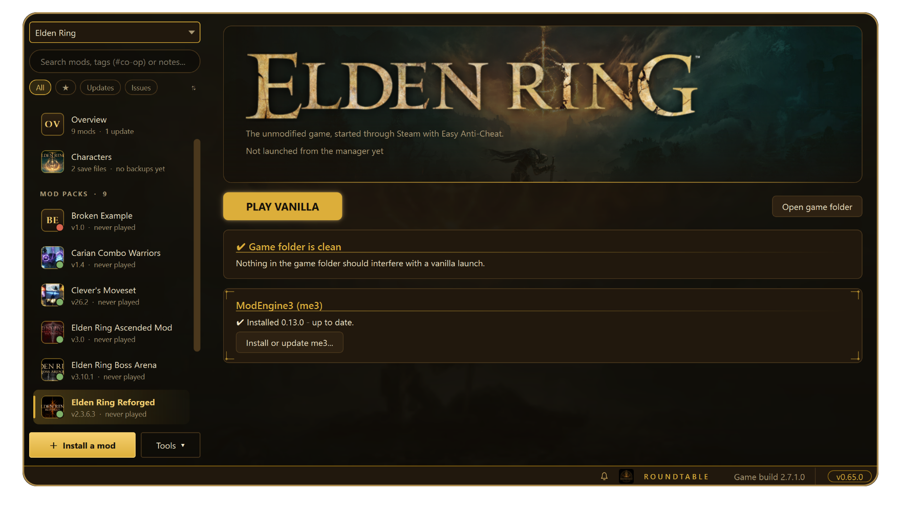](docs/images/theme-tree_sentinel-full.png)

**Night's Cavalry**

[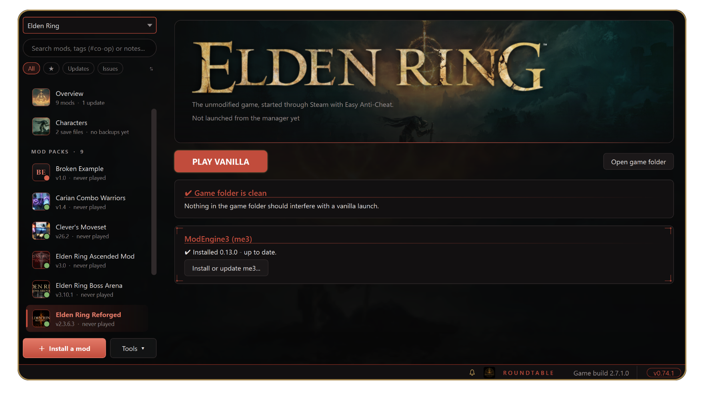](docs/images/theme-nights_cavalry-full.png)

**Carian Knight**

[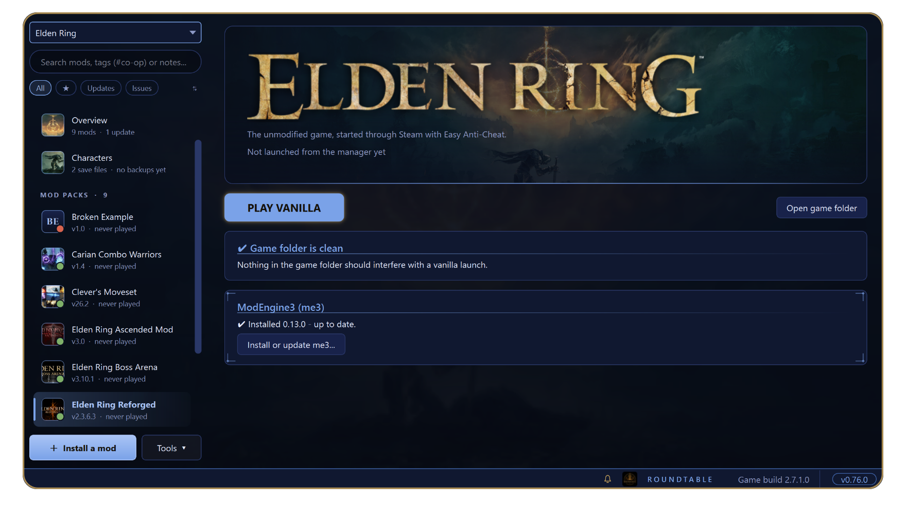](docs/images/theme-carian_knight-full.png)

**Black Knife Assassin**

[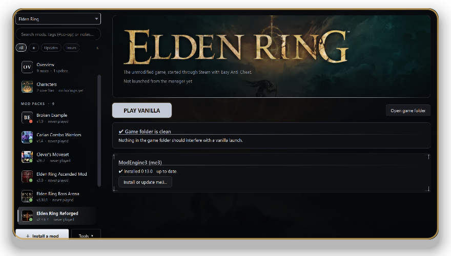](docs/images/theme-black_knife-full.png)

**Crucible Knight**

[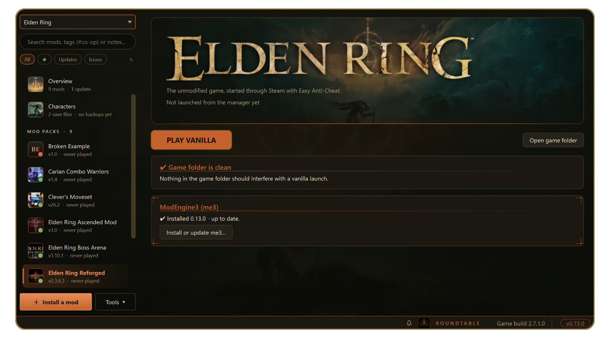](docs/images/theme-crucible_knight-full.png)

**Starscourge Radahn**

[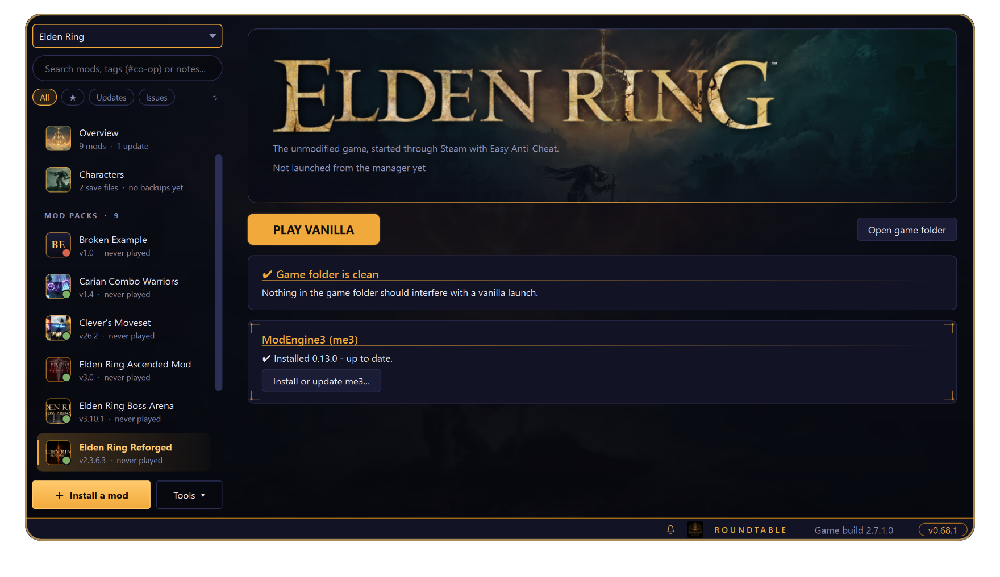](docs/images/theme-radahn-full.png)

**Dark Moon Ranni**

[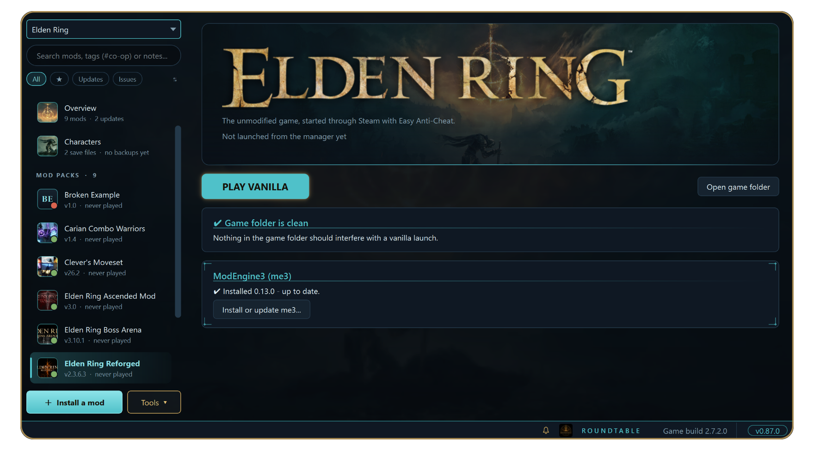](docs/images/theme-ranni-full.png)

**Lord of Blood**

[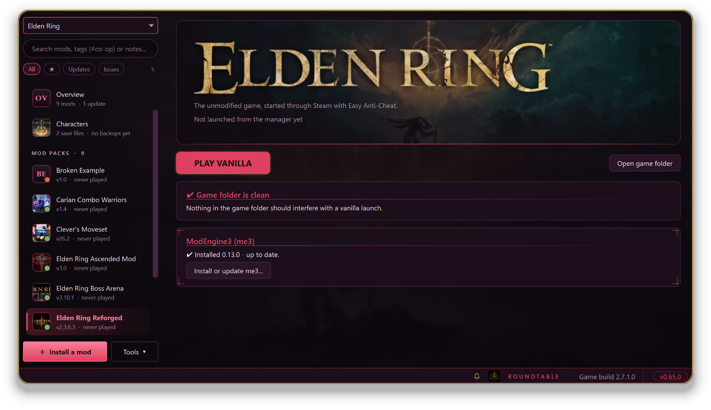](docs/images/theme-mohg-full.png)

**Scarlet Rot**

[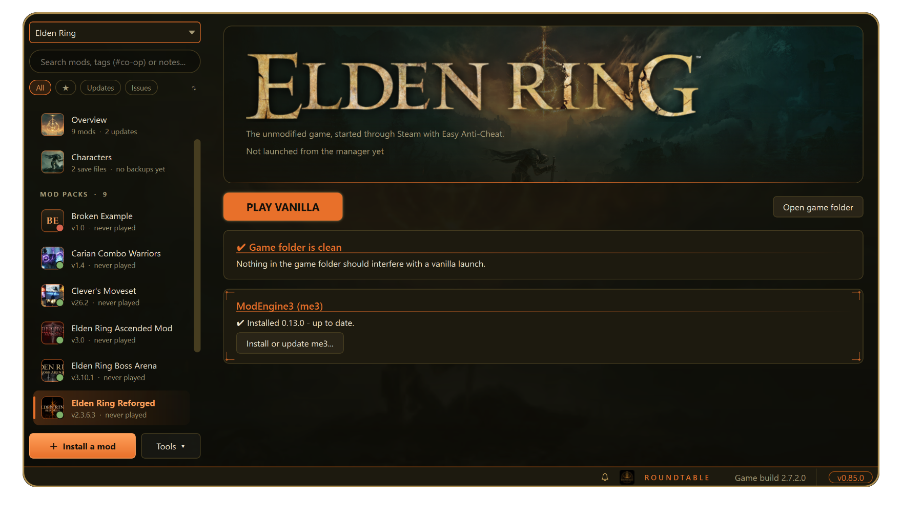](docs/images/theme-scarlet_rot-full.png)

**Haligtree**

[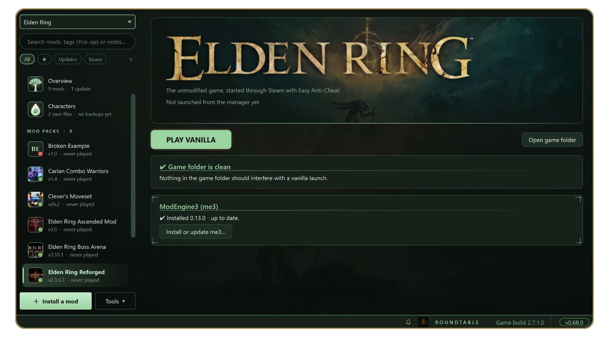](docs/images/theme-haligtree-full.png)

**St. Trina's Lily**

[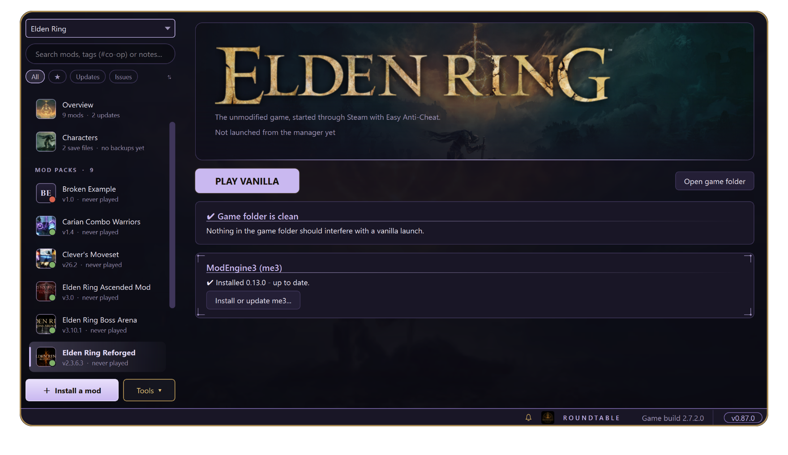](docs/images/theme-trina-full.png)

Prefer to mix your own? Choose **Custom mix** and pick any accent colour (or your own) and one of four colour schemes. You can also change the **text size**, the **font**, how **rounded** the corners are, the **width of the mod list**, how much **animation** you want (Off, Calm, Fluid, Lavish), switch on a **high-contrast** mode, or use **colour-blind friendly status colours** (blue / yellow / orange instead of green / amber / red).

---

## Everything it can do

A complete list, by topic. Most items are in the **Tools** menu or on a mod's page - and **Ctrl+K** finds any of them by name.

### Installing

- Search Nexus Mods (no key needed) with pictures, tags, descriptions, comments and bug reports; install from a `.zip` / `.7z` / `.rar` or a folder; drag a mod onto the window.
- Every install is previewed first and can be undone; profiles are repaired as a mod installs (moved paths, Mod Engine 2 / debug DLLs, missing files).
- DLL-only mods become **add-ons** attached to the mods you play, with undo and updates.
- **Nexus download buttons** (`nxm://`) send files here, free accounts included; **Import tracked mods** links your Nexus tracking list to your packs and can install the ones you don't have.
- One-time setup after install (install scripts, *Setup UI images*, a game-folder zip) is offered, never run silently.
- Packs built from other mods (FRZN's Merge Modpack) get a guided, resumable dependency install.
- Installs and updates me3 and the Visual C++ runtime from their official sources.

### Playing

- One **PLAY** button; vanilla through Steam, mods through me3; a mod's own launcher (such as Convergence's) can be added as a target.
- **Before you play** check: missing files, skipped DLLs, an old Seamless, a mod that refused this game version last time, a save file last used by a different mod.
- **Watched launch**, session tracking, playtime and a launch history that can switch off whatever you changed since the last good launch.
- **Setup steps** (a randomizer, a config tool) run before the game, on your terms; **Quick launches** start a named mod + profile + on/off combination in one click.
- **Clean game folder**: for mods that break when ReShade or Elden Mod Loader files sit in the game folder, PLAY moves them aside and puts them back afterwards. Nothing is deleted.
- Self-managing mods (Convergence) are left alone: no profile edits, no repairs that would fight their launcher.
- Desktop shortcuts that start a mod directly.

### When something goes wrong

- A warning when a mod is older than your last game patch; health check, profile check, **Fix problems** (undoable), **Why won't it start?**, last-launch report, **Doctor**, a requirements card for known mods, conflict check and file verification.
- Reads Windows crash records and offers to switch off the DLL to blame; **Find the cause** narrows a crash down by switching halves off.
- **Copy report** for help requests (personal paths removed); an error log with a *Copy details* dialog; *Report a problem* opens a pre-filled GitHub issue.
- **Go back to an earlier version** of Roundtable if an update misbehaves.

### Updates

- Mod updates from GitHub or Nexus with preview, backups and undo; patch-aware; the author's README steps are shown first; **Update from file...** for anything else.
- Add-on updates, me3 updates, game-patch awareness, and signed Roundtable updates (checked before anything is unpacked).
- A daily background check you can turn off.

### Co-op

- **Play with friends** checklist and invite; **Compare setups**; **Share my setup / Install a friend's setup** (a code, file or link); **Friends' setups** with a ready light per friend and a **Room** view.
- **Passwords and save files** in one window; **Seamless versions** sync; **Add Seamless Co-op** to any mod with its own save ending; change a save-file extension with the existing save copied across.
- **DLL presets** (and recommended sets) that never load a DLL twice; optional Discord posts that you approve first.

### Saves

- Automatic backups before every launch (and optionally every few minutes while you play), a second copy on another drive, restore, guarded deletes, character copying between saves, and a handoff to a save editor you already have for appearance changes. Roundtable never edits a save itself.

### Organising

- Components and load order, **Loadouts**, a tidy **Configuration** editor, favourites, tags and notes, **Organize DLL mods** (every mod gets its own copy, fully undoable), a **Known mods** list you can edit and share, setup backup and restore, and **Delete** that moves a mod aside (*Tools → Deleted mods* restores it).
- **Storage** and **Clean up downloads** with optional automatic limits.

### More games

- Elden Ring, **Elden Ring Nightreign** and **Dark Souls III** each keep their own mods folder, profiles and save backups. A game library finds the others you own; Dark Souls 1 and 2 get Play and save backups, and **Bloodborne** (the community Windows port) gets Play, a health check, every launcher setting and a controller check without touching the game files.

### Look and feel

- Works from the keyboard (Tab, Enter, Escape, a visible focus outline) and names every setting for screen readers.
- Twelve themes, a light theme, text size, fonts, corner style, motion levels, high contrast and colour-blind status colours; a first-run tour and a *Getting started* checklist; **Ctrl+K**, **Ctrl+F**, **Ctrl+N**, **Ctrl+Enter** and **F1**.

### Safety

- Every file Roundtable changes is backed up first, and the author's originals are kept.
- Archives that try to write outside their folder are rejected; releases are signed; your Nexus key and Discord webhook are stored encrypted with Windows' own protection.
- Online mode is never switched on for you.

---

## Something went wrong?

<b>The game started but my mod isn't there / "ModEngine3 failed to load"</b>

1. Press **Why won't it start?** on the mod's page, or open **Tools → Health and storage → PC check (Doctor)**. They list exactly what's wrong in plain words and have buttons for the common fixes (install me3, install the Visual C++ runtime, find me3).
2. On the mod's page press **Fix problems...** - it repairs moved files, switches off mod files that can't work, and so on.
3. Make sure the mod is **not** inside a OneDrive folder, and that the manager and your mods aren't inside the Elden Ring game folder.
4. Still stuck? On the mod's page press **Check last launch**, then **Copy report**, and send it to whoever is helping you (personal paths are removed from the report).

<b>Windows says "Windows protected your PC"</b>

Click **More info → Run anyway**. The program isn't signed with a paid certificate, which is all this warning means.

<b>My friend can't join my game</b>

Use **Play with friends → Compare setups** on both PCs. It lists what differs - Seamless version, DLLs, settings, password. The most common cause is a different Seamless Co-op version or a different password.

<b>I changed a save-file ending and my character "disappeared"</b>

The character is still in the old save file. In **Tools → Seamless Co-op → Passwords and save files...** tick *copy the existing save to the new name* when you change an ending - or use the **Characters** page to copy it across afterwards.

<b>Where does the manager keep my information? How do I uninstall it?</b>

Your settings, Nexus key and backups are in the **`data`** folder next to `Roundtable.exe`. Nothing is uploaded. To uninstall, close the manager and delete its folder - your mods and saves are not touched. (me3 can be removed from Windows' *Installed apps*.)

<b>Do I need Nexus Premium?</b>

No. Free accounts work: use the *Mod Manager Download* button on a mod page (see above). Premium accounts additionally get fully automatic downloads.

<b>Can I get banned?</b>

Modded **online** play can get an account banned. The manager never switches online mode on by itself, and warns you if a profile has it enabled. Play offline, or use Seamless Co-op, which is its own separate network.

---

## Privacy and safety

- Your Nexus key and Discord webhook stay on your PC, stored **encrypted with Windows' own protection**, and are only sent to nexusmods.com / discord.com.
- **Updates are signed.** The manager refuses an update whose signature doesn't check out.
- The manager contacts GitHub (to check for its own updates and for me3), Nexus Mods, Microsoft (only if you ask it to install the Visual C++ runtime) and - only if you set one up - the Discord webhook you choose. It does not send your files or saves anywhere.
- Mods are always downloaded from the author's own page. This project never hosts or re-shares mod files.
- Nothing that touches your saves or your mods is done without a backup, and the common ones can be undone from inside the app.

## Credits and notes

This is an unofficial fan tool. It is not affiliated with FromSoftware, Bandai Namco, Nexus Mods, or the authors of me3 or Seamless Co-op - please support the mod authors whose work you install.

Thanks to **me3 / ModEngine 3** (garyttierney), **Seamless Co-op** (LukeYui), and the open-source **ER-Save-Editor** (ClayAmore, Apache-2.0), whose documentation of the save format made the character tools possible.

*Elden Ring* is a trademark of FromSoftware / Bandai Namco. Screenshots show the game's artwork and the pictures mod authors publish on their Nexus pages; those belong to their owners. Third-party software in the program is listed in `THIRD-PARTY-NOTICES.txt`.

**Found a bug or have an idea?** Open an **[Issue](https://github.com/Nexus-Primes/Roundtable/issues)** and, if you can, paste the text from the manager's *Copy report* button.
