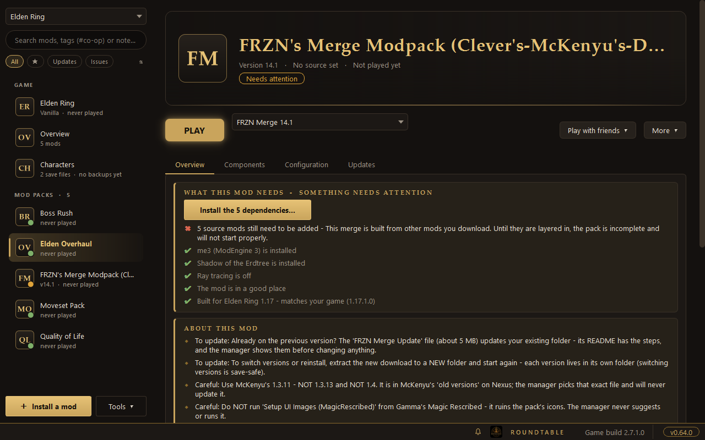
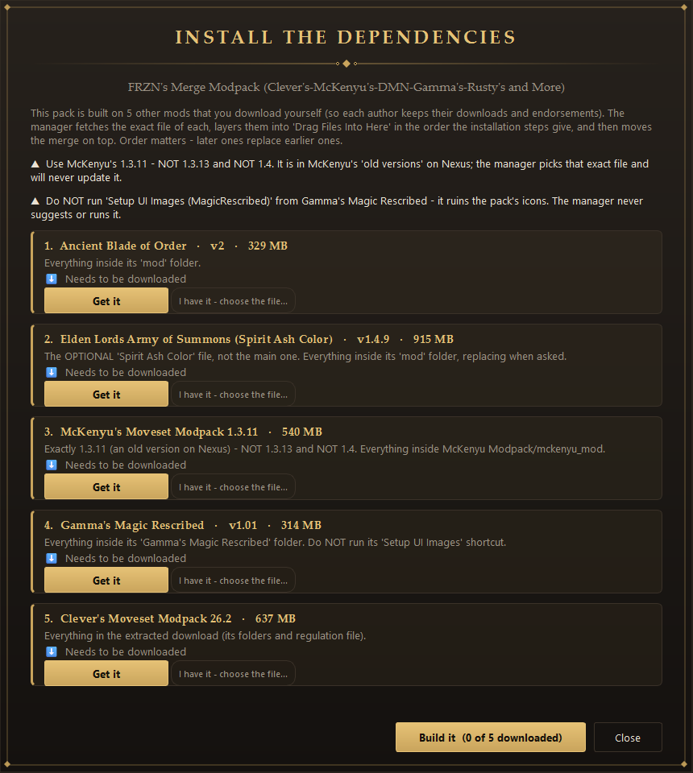
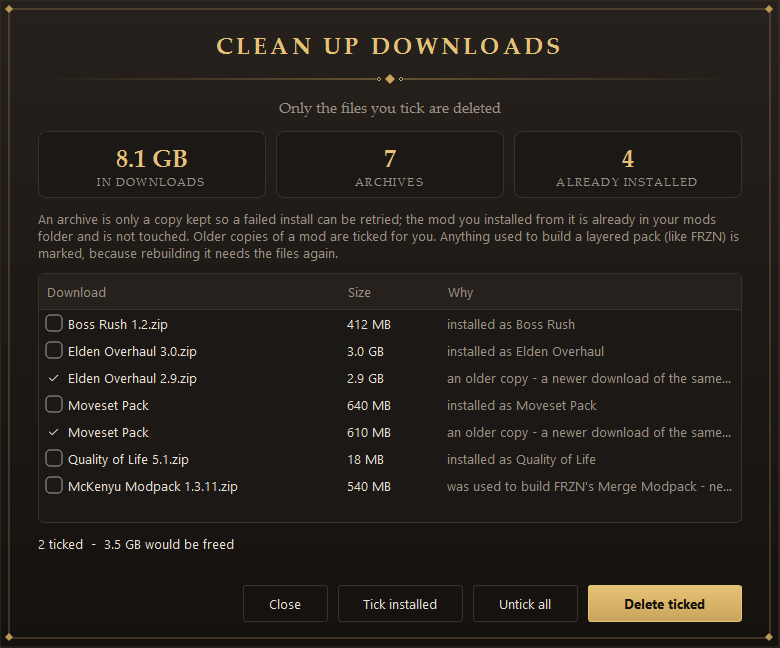

<h1 align="center">Roundtable</h1>

<b>Install, organise and play Elden Ring mods - and play co-op with friends - without digging through folders.</b>

  <a href="https://github.com/Nexus-Primes/Roundtable/releases/latest"><b>Download for Windows</b></a>
  &nbsp;·&nbsp; <a href="docs/GUIDE.md">Step-by-step guide</a>
  &nbsp;·&nbsp; <a href="docs/FEATURES.md">Everything it can do</a>

## What you get

- **One PLAY button.** Pick a mod and press it. Roundtable looks the mod over first, tells you in plain words if something will go wrong, and checks afterwards that your mod really loaded.
- **Big mod packs, set up for you.** It knows what the major overhauls need (me3, the DLC, the right game version) and walks you through the rest - even packs built from five other mods.
- **Co-op without the guesswork.** Matching versions, passwords and save files for you and your friends, in one place.
- **Your characters stay safe.** Automatic save backups, and nothing is deleted without asking.

> Windows only · needs Elden Ring on Steam · no programming knowledge required.

## A closer look

<table>
  <tr>
    <td width="50%" valign="top"> <b>Knows what each mod needs.</b> A clear checklist for your PC, with a button for each thing that's missing.</td>
    <td width="50%" valign="top"> <b>Packs built from other mods.</b> The exact files, in the right order, layered in for you.</td>
  </tr>
  <tr>
    <td width="50%" valign="top"> <b>Play with friends.</b> A green checklist and a ready-to-send invite.</td>
    <td width="50%" valign="top"> <b>Characters and saves.</b> See every character, back them up, copy them between saves.</td>
  </tr>
  <tr>
    <td width="50%" valign="top"> <b>Tidy disk space.</b> See which old downloads can go. Nothing is removed until you tick it.</td>
    <td width="50%" valign="top"> <b>Make it yours.</b> Twelve themes and an animation level you can turn down.</td>
  </tr>
</table>

## Start in three steps

1. **Download** the file ending in `-windows.zip` from the [latest release](https://github.com/Nexus-Primes/Roundtable/releases/latest).
2. **Unzip it** into a simple folder such as `C:\Tools\Roundtable` (not Downloads, Desktop or OneDrive).
3. **Open `Roundtable.exe`.** The first time, Windows may say *"Windows protected your PC"* - click **More info**, then **Run anyway**. Roundtable then tells you what's missing and offers to install it.

New to mods? The [guide](docs/GUIDE.md) covers installing your first mod, co-op, and what to do when something goes wrong.

## Questions

<b>Do I need Nexus Premium?</b>

No. A free account works: turn on *Nexus download buttons* in Settings and the *Mod Manager Download* button on a mod page sends the file here. Premium adds fully automatic downloads.

<b>Can I get banned?</b>

Modded **online** play can get an account banned. Roundtable never turns online mode on and warns you if a profile has it. Play offline, or use Seamless Co-op, which is its own network.

<b>The game started but my mod isn't there</b>

On the mod's page press **Why won't it start?**, or open **Tools -> PC check**. They list what's wrong in plain words and fix the common causes. The [guide](docs/GUIDE.md) has more.

## Safety and privacy

- Your Nexus key stays on your PC, encrypted with Windows' own protection, and is only sent to nexusmods.com.
- Updates are **signed**; Roundtable refuses an update whose signature doesn't check out.
- Nothing that touches your saves or mods happens without a backup, and most changes can be undone from inside the app.
- Mods are always downloaded from the author's own page. This project never hosts or shares mod files.

Found a bug or have an idea? Open an [issue](https://github.com/Nexus-Primes/Roundtable/issues) and, if you can, paste the text from the *Copy report* button.

---

An unofficial fan tool, not affiliated with FromSoftware, Bandai Namco, Nexus Mods, or the authors of me3 or Seamless Co-op - please support the mod authors whose work you install. Thanks to me3 / ModEngine 3 (garyttierney), Seamless Co-op (LukeYui) and ER-Save-Editor (ClayAmore). *Elden Ring* is a trademark of FromSoftware / Bandai Namco. Third-party software is listed in `THIRD-PARTY-NOTICES.txt`.
