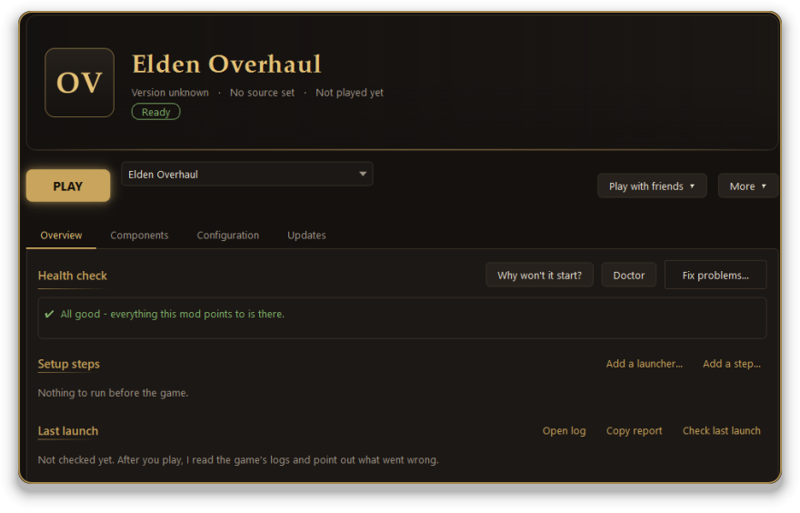
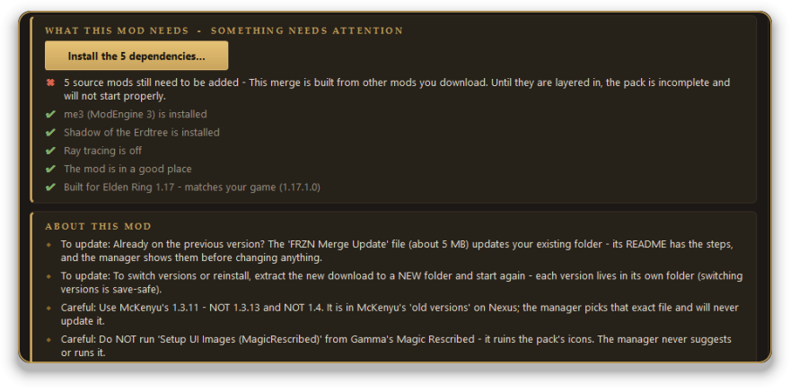
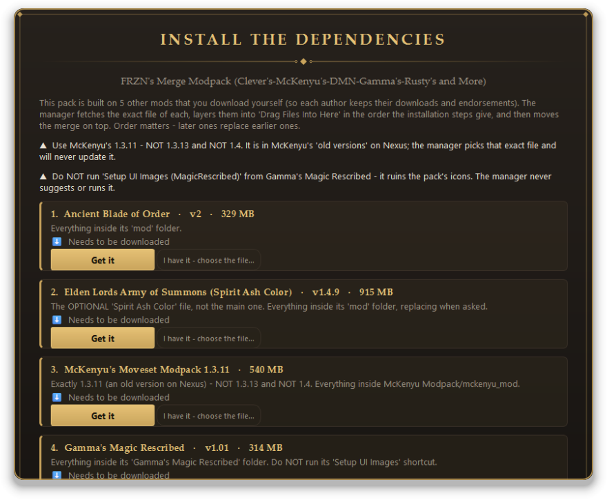
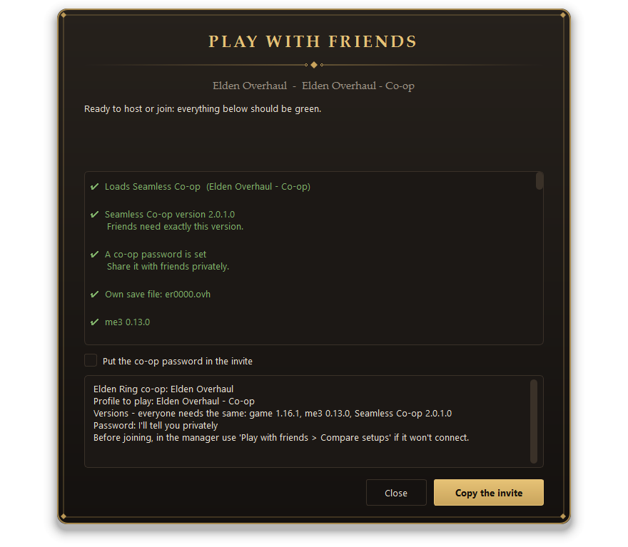
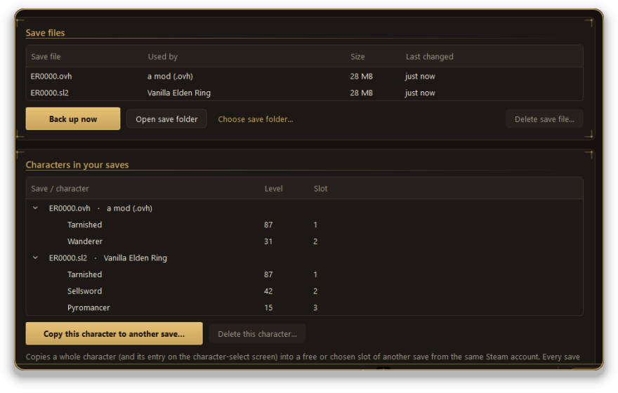
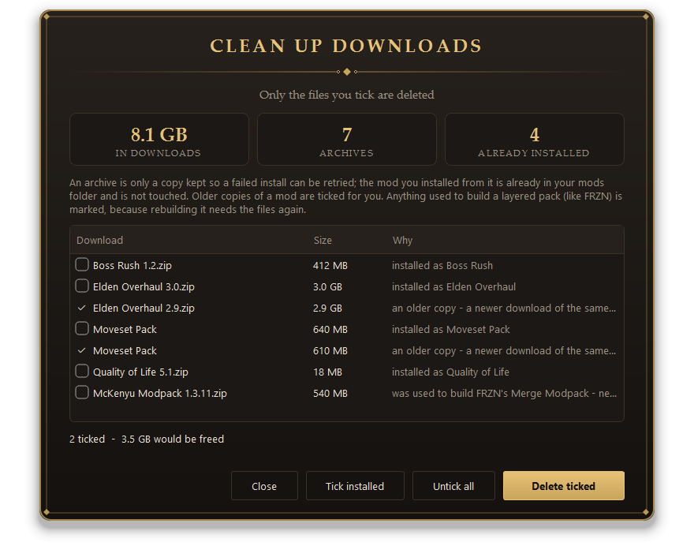

  

  

  
  
  

  <a href="docs/GUIDE.md"><b>Step-by-step guide</b></a> &nbsp;·&nbsp;
  <a href="docs/FEATURES.md"><b>Everything it can do</b></a> &nbsp;·&nbsp;
  <a href="https://github.com/Nexus-Primes/Roundtable/issues"><b>Report a problem</b></a>

 

## Why Roundtable

<table>
  <tr>
    <td width="25%" valign="top"><h4>One PLAY button</h4>Pick a mod and press it. Roundtable checks the mod first and tells you in plain words if something will go wrong.</td>
    <td width="25%" valign="top"><h4>Big packs, set up for you</h4>It knows what the major overhauls need, and layers in the other mods a pack is built from.</td>
    <td width="25%" valign="top"><h4>Co-op, sorted</h4>Matching versions, passwords and save files for you and your friends, in one place.</td>
    <td width="25%" valign="top"><h4>Saves stay safe</h4>Automatic backups, and nothing is deleted without asking. Most changes can be undone.</td>
  </tr>
</table>

 

## How it works

### 1. Install a mod and press PLAY

Press **Install a mod** (bottom left). Search Nexus, or pick a `.zip`, `.7z` or `.rar` you already downloaded, look over what Roundtable found, and press **Install**. Then click the mod in the list and press **PLAY**.

Before the game starts, Roundtable looks the mod over and tells you in plain words if something is likely to go wrong. If a mod won't start, **Why won't it start?** explains what happened.

### 2. See what each mod needs

Open a mod's **Overview** tab. The **What this mod needs** card checks your PC against what that mod asks for - me3, the DLC, ray tracing, the game version - and puts a button next to anything that's missing. Press the button, or follow the one-line advice. **About this mod** lists the author's own warnings and how to update it.

### 3. Packs built from other mods

Some packs, like FRZN's Merge Modpack, are built from other mods that you download yourself. After you install one, the **Install the dependencies** window opens (or press the button on the pack's *What this mod needs* card).

Press **Get it** on each mod: a Premium Nexus account downloads it for you; a free account opens the Nexus page, and the *Mod Manager Download* button there sends the file back. Already downloaded it? Roundtable spots it in your Downloads folder. When all are ready, press **Build it** - the files are layered in the right order for you.

### 4. Play with friends

On a mod's page press **Play with friends**. Everything should be green: the same Seamless Co-op version for everyone, a co-op password, and a save file of its own. Press **Copy the invite** and send it to your friends.

If someone can't join, use **Compare setups** on both PCs - it lists exactly what differs.

### 5. Keep your characters safe

Click **Characters** in the list on the left. You see every save file, which mod uses it, and the characters inside. Press **Back up now** at any time (backups also happen automatically before each launch), or copy a character into another save.

### 6. Clear out old downloads

Open **Tools** and choose **Storage...**, then **Choose downloads to delete...**. Each download says why it can go - the mod is already installed, or it's an older copy. Older copies are ticked for you; tick any others you like and press **Delete ticked**. Nothing is removed until you confirm, and installed mods are never touched.

### 7. Make it yours

Open **Tools** and choose **Appearance...**. Pick one of twelve themes, change the text size, and choose how much animation you want - or turn it off.

## Start in three steps

<table>
  <tr>
    <td width="8%" align="center"><h2>1</h2></td>
    <td><b>Download</b> the file ending in <code>-windows.zip</code> from the <a href="https://github.com/Nexus-Primes/Roundtable/releases/latest">latest release</a>.</td>
  </tr>
  <tr>
    <td align="center"><h2>2</h2></td>
    <td><b>Unzip it</b> into a simple folder such as <code>C:\Tools\Roundtable</code> - not Downloads, Desktop or OneDrive.</td>
  </tr>
  <tr>
    <td align="center"><h2>3</h2></td>
    <td><b>Open <code>Roundtable.exe</code>.</b> If Windows says <i>"Windows protected your PC"</i>, click <b>More info</b>, then <b>Run anyway</b>. Roundtable then tells you what's missing and offers to install it.</td>
  </tr>
</table>

> New to mods? The [guide](docs/GUIDE.md) walks through your first mod, co-op, and what to do when something goes wrong.

 

## Questions

<b>Do I need Nexus Premium?</b>

 
No. A free account works: turn on <i>Nexus download buttons</i> in Settings and the <i>Mod Manager Download</i> button on a mod page sends the file here. Premium adds fully automatic downloads.

<b>Can I get banned?</b>

 
Modded <b>online</b> play can get an account banned. Roundtable never turns online mode on and warns you if a profile has it. Play offline, or use Seamless Co-op, which is its own network.

<b>The game started but my mod isn't there</b>

 
On the mod's page press <b>Why won't it start?</b>, or open <b>Tools -> PC check</b>. They list what's wrong in plain words and fix the common causes. The <a href="docs/GUIDE.md">guide</a> has more.

<b>Is it safe? What does it send?</b>

 
Your Nexus key stays on your PC, encrypted with Windows' own protection, and is only sent to nexusmods.com. Updates are <b>signed</b>, and Roundtable refuses one whose signature doesn't check out. Mods are always downloaded from the author's own page - this project never hosts or shares mod files.

 

---

An unofficial fan tool, not affiliated with FromSoftware, Bandai Namco, Nexus Mods, or the authors of me3 or Seamless Co-op - please support the mod authors whose work you install. 
Thanks to me3 / ModEngine 3 (garyttierney), Seamless Co-op (LukeYui) and ER-Save-Editor (ClayAmore). <i>Elden Ring</i> is a trademark of FromSoftware / Bandai Namco.

