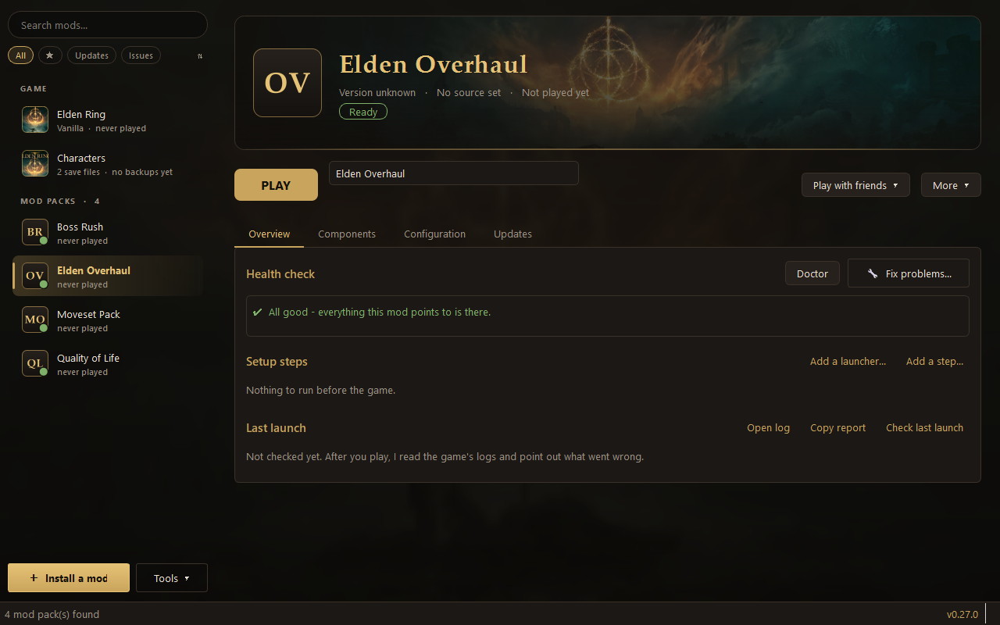
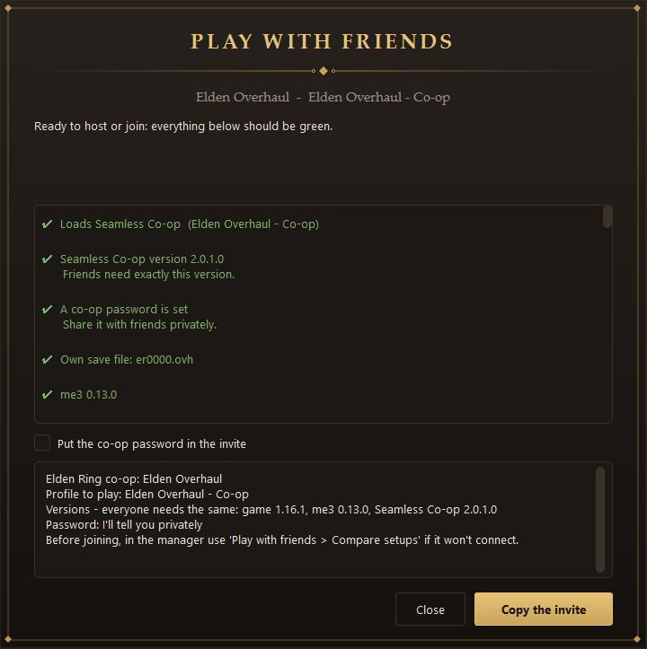
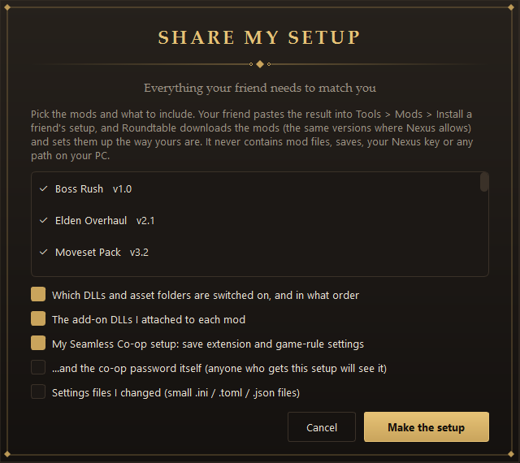
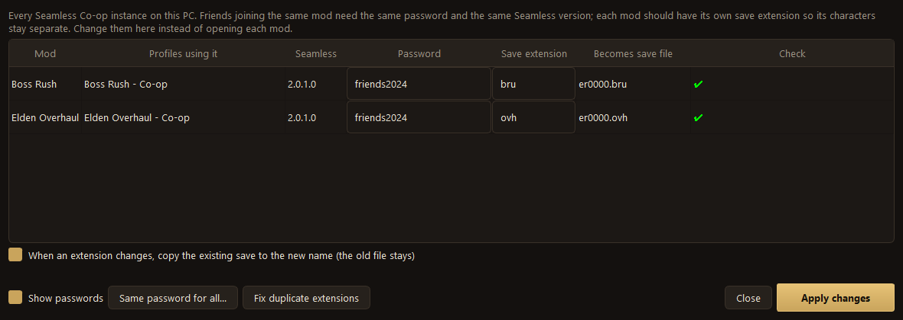
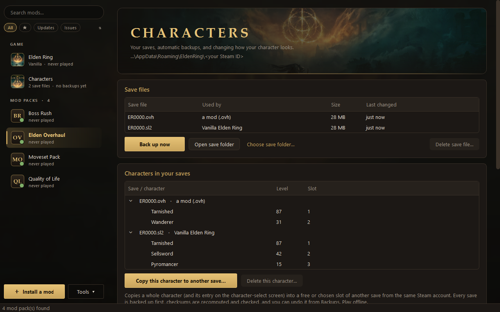
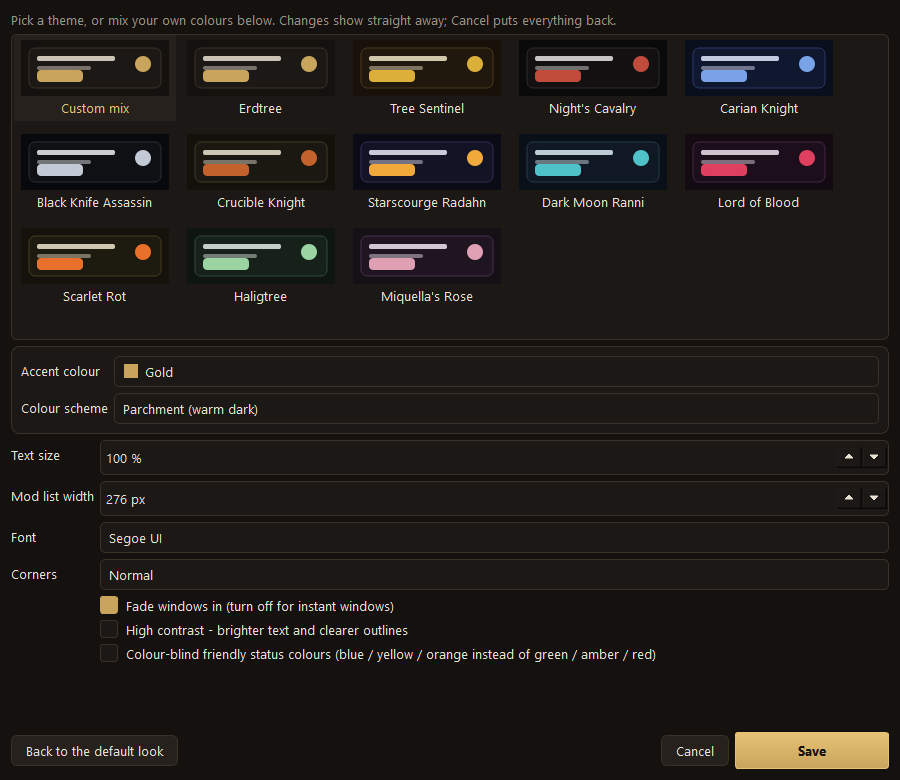
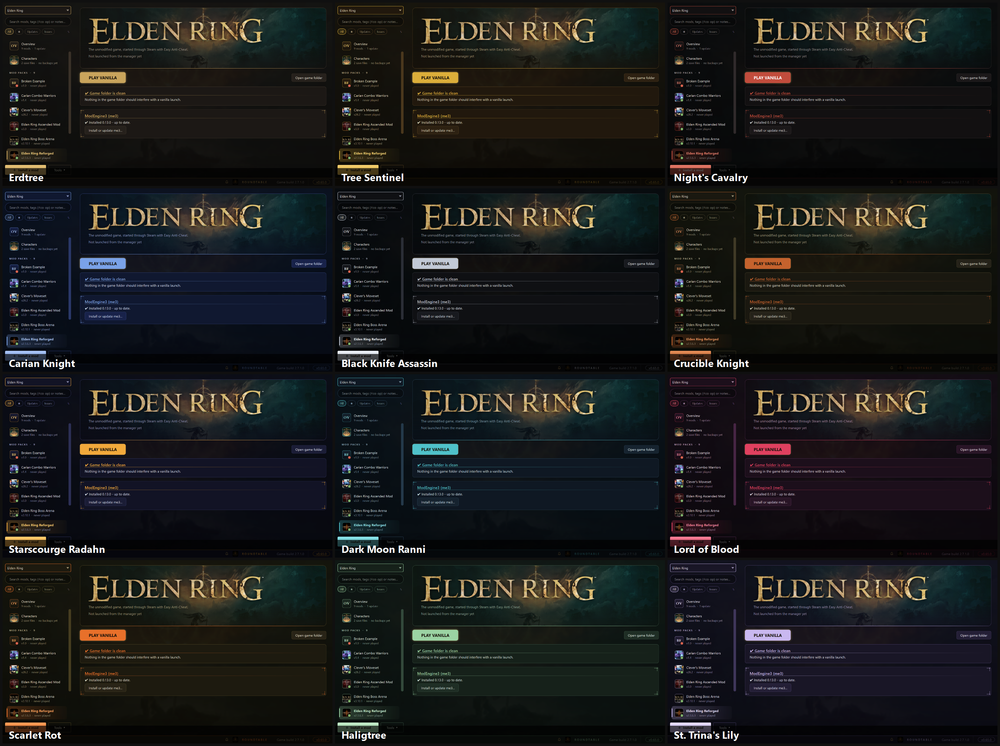
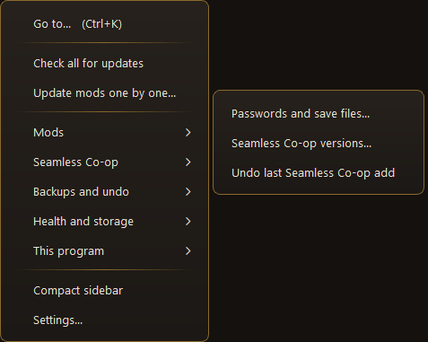

# Roundtable

*(formerly "ER Mod Manager")*

**A friendly way to install, organise and play Elden Ring mods - and to play co-op with your friends - without digging through folders.**

If you've ever unzipped a mod, wondered which folder it goes in, and then watched the game start without it - this is for you. You pick a mod, press **PLAY**, and the manager takes care of the awkward parts: putting files in the right place, checking for problems *before* the game starts, keeping your saves safe, and keeping everything up to date.

> **Windows only.** Needs Elden Ring on Steam. You do **not** need to know anything about programming.

---

## What it does for you

| You want to... | The manager... |
|---|---|
| **Install a mod** | Searches Nexus Mods or opens the file you downloaded, shows you what's inside, installs it, and fixes the usual profile mistakes automatically. |
| **Play it** | One **PLAY** button. It looks the mod over first and tells you in plain words if something will go wrong - then watches the game start and tells you if your mod didn't load. |
| **Play with friends** | Checks your co-op setup, helps everyone use the same password and versions, and writes you an invite to send. |
| **Keep your characters safe** | Backs up your saves automatically, can keep a second copy somewhere else, and asks twice before anything involving a save is deleted. |
| **Stay up to date** | Tells you when a mod, me3 or the manager itself has a new version - and updates without you leaving the app. |
| **Undo mistakes** | Almost everything it does is backed up and can be undone. |

---

## Get started (about 5 minutes)

### 1. Download

Open the **[Releases page](../../releases/latest)** and download the file ending in **`-windows.zip`** (it's listed under *Assets*).

### 2. Unzip it somewhere permanent

Right-click the zip and choose **Extract All...** into a simple folder such as `C:\Tools\Roundtable`.

> **Please don't** run it from inside the zip, from your *Downloads* or *Desktop*, from a **OneDrive** folder, or from inside the Elden Ring folder. Windows and OneDrive can lock or hide files there, which causes confusing errors.

### 3. Open `Roundtable.exe`

The first time, Windows may say **"Windows protected your PC"**. That's because the program isn't signed with a paid certificate. Click **More info**, then **Run anyway**.

### 4. Let it set itself up

On the first start the manager tells you what's missing. The two things it needs are:

- **me3** (ModEngine 3) - the small program that actually loads mods into the game.
  In the manager choose **Tools → This program → Install or update me3...** and follow the installer's window like any other installer. When it closes, the manager finds it by itself.
- **The Microsoft Visual C++ runtime** - almost every DLL mod needs it. If it's missing, the same window offers to install it for you.

Then open **Settings** and make sure the **Mods folder** is the folder where your mods will live (an empty folder is fine - the manager will fill it).

### 5. (Optional but handy) Add your Nexus Mods key

A free Nexus Mods account lets the manager search for mods, show their pictures, and check for updates.

1. Log in at nexusmods.com and open your account's **API Keys** page.
2. Copy the **Personal API Key**.
3. Paste it into **Settings → Nexus API key** and press **Test key**.

The key stays on your PC and is only ever sent to nexusmods.com.

---

## Installing and playing your first mod

1. Press **＋ Install a mod** (bottom-left).
2. Either **search Nexus** and pick a mod, or choose a `.zip`, `.7z` or `.rar` you already downloaded.
3. Look over what the manager found, press **Install**. It repairs common problems for you and says what it did.
4. Click the mod in the list on the left and press **PLAY**.

**Tip - the "Mod Manager Download" button.** In **Settings**, turn on **Nexus download buttons**. After that, the *Mod Manager Download* button on a Nexus mod page sends the file straight here. This works with free Nexus accounts, too.

**Some mods are "add-ons"** (small DLL files like free-camera or UI tweaks). When you install one, the manager offers to add it to the mods you already play instead of making it a separate mod.

---

## Playing co-op with friends (Seamless Co-op)

Co-op only works when **everyone has the same mod versions, the same Seamless Co-op version, and the same password.** The manager makes that much less painful.

- **Play with friends → Ready to play?** on a mod's page shows a checklist (Seamless version, password, your own save file, me3, game version) and a ready-to-send **invite** you can copy or post to Discord.
- **Add Seamless Co-op...** (on the mod's *Components* tab) puts Seamless into a mod for you, with its own save file so characters never get mixed up.
- Friends who have the manager can use **Tools → Mods → Install a friend's setup** - paste the setup (or a link to it) you made with **Share my setup** and it downloads the same mod versions, adds your add-on DLLs, sets up Seamless Co-op, and switches the same DLLs on in the same order. The co-op password and settings files are only included if you tick them.
  
  Before it changes anything, the friend sees a plain list of what will change and can go back; **Tools → Backups and undo → Undo last friend's setup** reverses it. Tip: put your setup in a GitHub gist and send friends the link - when you change your setup you update the gist, and they just open *Install a friend's setup* and press *Read it* again.
- **Play with friends → Compare setups** finds out exactly *why* two people can't connect.

### Your DLL preset, without duplicates

Save the DLL mods you use everywhere as a **DLL preset** (*Tools → Mods → DLL presets...*) and add it to any mod in one click. If a mod already has one of the same DLLs, Roundtable asks which copy to use - the mod's or yours - so nothing is ever loaded twice, and undoing it puts everything back.

### All your passwords and save files in one place

**Tools → Seamless Co-op → Passwords and save files...** lists every co-op setup on your PC. Change passwords and save-file endings there (even set one password for everything), see which ones clash, and let the manager give each mod its own. If you change a save ending, it can copy your existing save across so your character comes with you.

---

## Your saves are protected

The **Characters** page (top of the list) shows every save file and the characters inside it.

- **Backups happen automatically** before you launch, and before anything that touches a save. Unchanged saves share space, so keeping many costs little.
- **A second copy** can be sent to another drive, a NAS or a cloud-synced folder (*Backups → Second copy*).
- **Copy a character** from one save to another - for example from your normal game into your co-op save - with *Copy this character to another save...*. It only works between saves from the same Steam account, checks everything first, and makes a backup first.
- **Deleting is guarded.** Deleting a character or a whole save file makes a protected backup first, shows you exactly what will go, and makes you **type the name** before it does anything. Deleted save files are moved aside, not erased, and *Backups → Restore* brings them back.
- Please **play offline** with copied or edited characters. Online play with mods can get an account banned, and the manager never turns online mode on by itself.

---

## Keeping up to date

- **Mods:** *Tools → Check all for updates* compares your mods with their Nexus or GitHub pages. *Update this mod* downloads and applies a new version safely, and *Undo last update* reverses it.
- **me3:** the manager checks about once a day and tells you when a newer one is out - *Tools → This program → Update me3...*.
- **The manager itself:** when a new version is published, a banner appears in the sidebar. Click it and the manager downloads the update, restarts, and keeps all your settings and backups.
  If a new version ever misbehaves, **Tools → This program → Go back to an earlier version...** returns to the one you had before (it's saved on your PC automatically) or to any older release - your data stays as it is.

---

## Make it yours

Open **Tools → This program → Appearance...** and pick a theme. Each one is a complete colour scheme named after something from the Lands Between:

Click a theme and the whole manager changes straight away - **Cancel** puts everything back, **Save** keeps it.

Prefer to mix your own? Choose **Custom mix** and pick any accent colour (or your own) and one of four colour schemes. You can also change the **text size**, the **font**, how **rounded** the corners are, the **width of the mod list**, turn the window fade-in off, switch on a **high-contrast** mode, or use **colour-blind friendly status colours** (blue / yellow / orange instead of green / amber / red).

Everything else lives in the **Tools** menu, grouped by topic:

---

## Something went wrong?

<b>The game started but my mod isn't there / "ModEngine3 failed to load"</b>

1. Open **Tools → Health and storage → PC check (Doctor)**. It lists exactly what's wrong in plain words and has buttons for the common fixes (install me3, install the Visual C++ runtime, find me3).
2. On the mod's page press **Fix problems...** - it repairs moved files, switches off mod files that can't work, and so on.
3. Make sure the mod is **not** inside a OneDrive folder, and that the manager and your mods aren't inside the Elden Ring game folder.
4. Still stuck? On the mod's page press **Check last launch**, then **Copy report**, and send it to whoever is helping you (personal paths are removed from the report).

<b>Windows says "Windows protected your PC"</b>

Click **More info → Run anyway**. The program isn't signed with a paid certificate, which is all this warning means.

<b>My friend can't join my game</b>

Use **Play with friends → Compare setups** on both PCs. It lists what differs - Seamless version, DLLs, settings, password. The most common cause is a different Seamless Co-op version or a different password.

<b>I changed a save-file ending and my character "disappeared"</b>

The character is still in the old save file. In **Tools → Seamless Co-op → Passwords and save files...** tick *copy the existing save to the new name* when you change an ending - or use the **Characters** page to copy it across afterwards.

<b>Where does the manager keep my information? How do I uninstall it?</b>

Your settings, Nexus key and backups are in the **`data`** folder next to `Roundtable.exe`. Nothing is uploaded. To uninstall, close the manager and delete its folder - your mods and saves are not touched. (me3 can be removed from Windows' *Installed apps*.)

<b>Do I need Nexus Premium?</b>

No. Free accounts work: use the *Mod Manager Download* button on a mod page (see above). Premium accounts additionally get fully automatic downloads.

<b>Can I get banned?</b>

Modded **online** play can get an account banned. The manager never switches online mode on by itself, and warns you if a profile has it enabled. Play offline, or use Seamless Co-op, which is its own separate network.

---

## Privacy and safety

- Your Nexus key stays on your PC and is only sent to nexusmods.com.
- The manager contacts GitHub (to check for its own updates and for me3), Nexus Mods, and - only if you set one up - the Discord webhook you choose. It does not send your files or saves anywhere.
- Mods are always downloaded from the author's own page. This project never hosts or re-shares mod files.
- Nothing that touches your saves or your mods is done without a backup, and the common ones can be undone from inside the app.

## Credits and notes

This is an unofficial fan tool. It is not affiliated with FromSoftware, Bandai Namco, Nexus Mods, or the authors of me3 or Seamless Co-op - please support the mod authors whose work you install.

Thanks to **me3 / ModEngine 3** (garyttierney), **Seamless Co-op** (LukeYui), and the open-source **ER-Save-Editor** (ClayAmore, Apache-2.0), whose documentation of the save format made the character tools possible.

*Elden Ring* is a trademark of FromSoftware / Bandai Namco.

**Found a bug or have an idea?** Open an **[Issue](../../issues)** and, if you can, paste the text from the manager's *Copy report* button.
