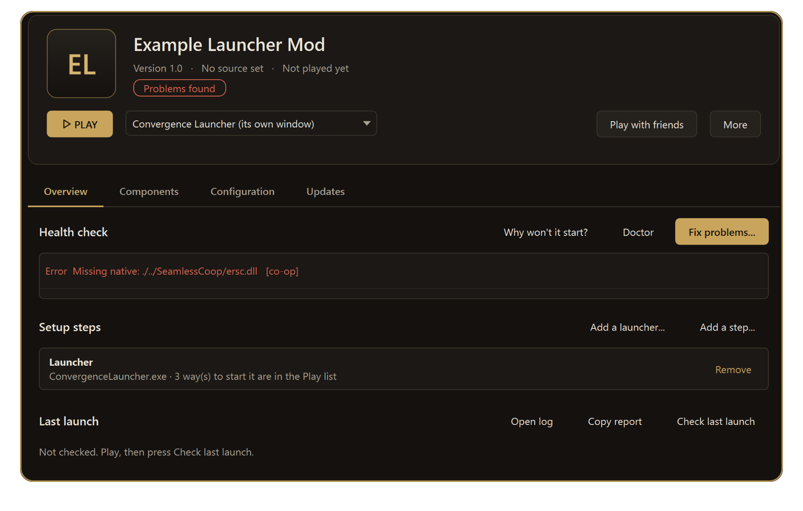
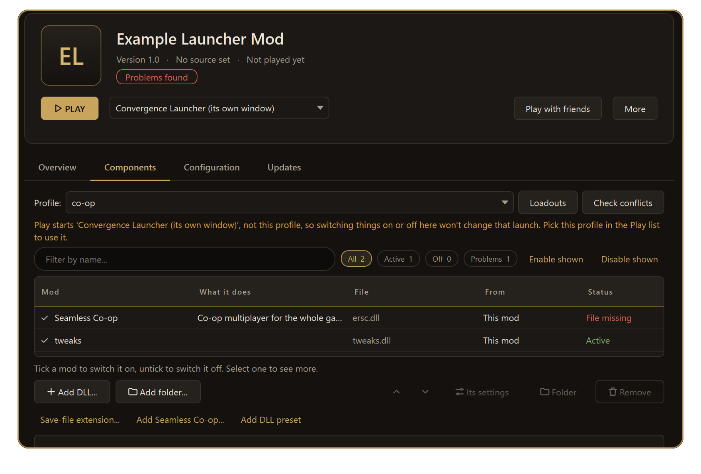
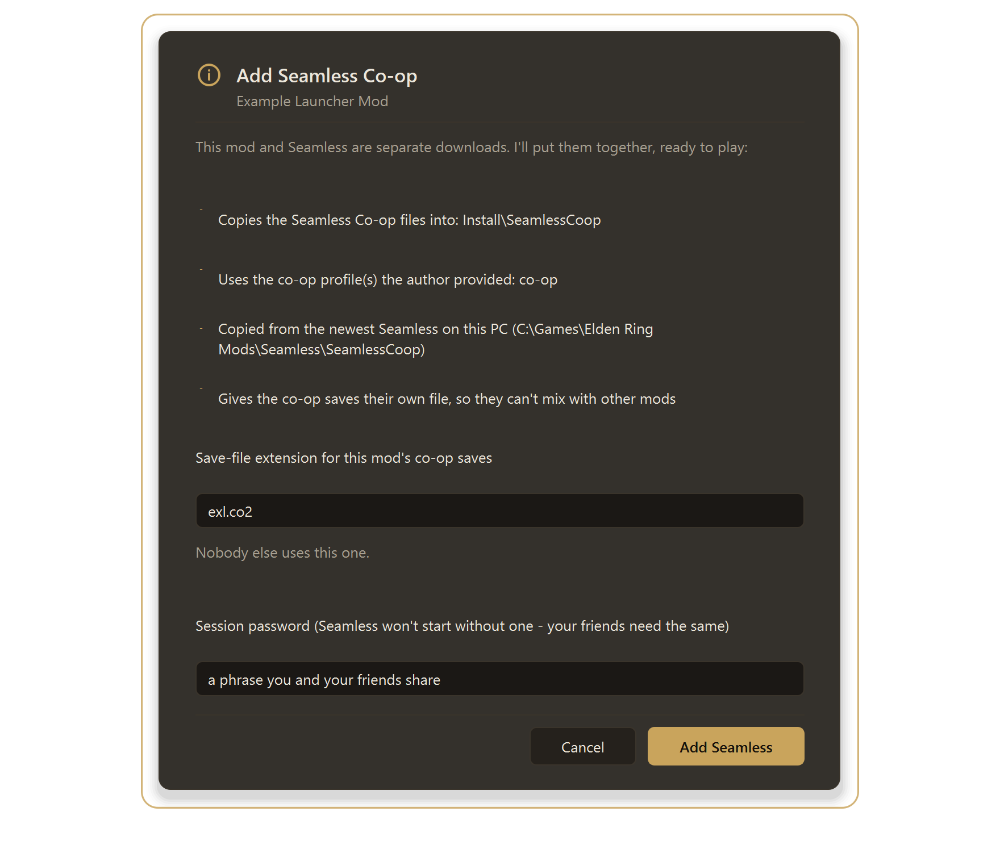

# Convergence in Roundtable

[Back to the main page](../README.md)

Convergence is an overhaul that **installs, updates and repairs itself through its own launcher**. Roundtable therefore leaves its files alone and works *with* the launcher instead of fighting it. This page covers the setup, what you can do, and what to expect.

**What you get**

- **PLAY opens the Convergence launcher on a page inside Roundtable.** Update, repair, and press the launcher's own *Launch* button without leaving the manager.
- A **health check** that understands the mod: it says what the mod itself needs and doesn't nag about things the launcher looks after.
- **Add DLL preset** for Convergence, when you allow it once.
- **Add Seamless Co-op** for Convergence: puts exactly what Seamless needs in exactly the place the mod looks for it, with its own save file.
- A **clean game folder** guard: ReShade and mod-loader files are moved aside while Convergence runs and put back afterwards.

*A made-up mod set up the way Convergence is: the launcher listed under Setup steps, PLAY set to open it, and the health check pointing out the co-op profile that is waiting for the Seamless folder.*

---

## 1. Install it

1. Get Convergence from its Nexus page (mod 3419) and use **its launcher** to install it. Use the **current (3.x)** version.
2. Let the launcher finish. It puts the mod in a folder inside your Mods folder (for example `Mods\The Convergence\ConvergenceER`).
3. Open Roundtable and, if it didn't notice by itself, choose **Tools → Mods → Rescan Mods folder**.

**Make sure it is the 3.x version.** Roundtable lists a mod's DLLs and offers *Add DLL preset* through the mod's `.me3` profile files, which 3.x has (in its `me3` folder). Old 2.x versions (their downloader from 2023) use ModEngine2 and have no `.me3` profile: the mod's *Components* tab stays empty and there is no preset button. If your folder holds a `modengine2_launcher.exe` and a `config_eldenring.toml`, it is the old kind; reinstall the current version with the launcher.

> You can also run the downloader or launcher `.exe` from **Install a mod** (choose the `.exe`). Roundtable tells you it is a program, runs it only if you say so, and then watches your Mods folder and rescans by itself when the install is done.

## 2. Attach the launcher

Roundtable needs to know where `ConvergenceLauncher.exe` is.

- On the mod's **Overview** tab, **Setup steps** shows a suggestion when it finds the launcher in the mod's folder, your **Downloads** or **Desktop**, or the folder your Mods folder sits in. Press **Use it to launch**.
- Or press **Add a launcher...** and choose `ConvergenceLauncher.exe`. **Keep that file name:** Roundtable recognises the launcher by it.

Adding it puts three entries in the mod's **Play list**:

| Entry | What it does |
|---|---|
| **Convergence Launcher (its own window)** | Opens the full launcher. **This is the default PLAY target** and the one shown inside Roundtable. |
| **Convergence - launch** | Starts the game straight away, without checking for updates. |
| **Convergence - update, then launch** | Checks for a new Convergence version, then starts it. |

The two quick entries start the launcher the usual way (it only shows a small status strip while it starts the game, so there is nothing to show).

## 3. Play

Press **PLAY**. The launcher's window appears on a page in Roundtable with *Back*, *Open in its own window* and *Close launcher* at the top. Use its buttons to update or repair, then its own **Launch**.

- The page keeps running if you go to another page; closing the launcher here does **not** close the game.
- If your display scaling isn't 100%, or you switched the option off (*Settings → Show a mod's own launcher (Convergence's) inside Roundtable*), the launcher opens in its own window as before.
- Pick another entry from the Play list any time; Roundtable remembers your choice.
- Before the game starts, Roundtable asks once about moving ReShade and mod-loader files aside ("A clean game folder"). Nothing is deleted.

## 4. Add your own DLLs (DLL presets)

Convergence's profiles accept extra DLLs, so your saved DLL preset can be added to it.

1. Open the mod, then the **Components** tab (or **Add DLL preset**).
2. The first time, Roundtable explains what it does and asks **Allow it for this mod**. That is remembered.
3. Pick a preset. Its DLLs go in an `extra dll mods` folder **beside** the mod and are listed in its profiles. A backup of each profile is kept, and **Tools → Backups and undo → Undo last add-on install** reverses it.

**Good to know**

- **The launcher can undo it.** When Convergence updates or repairs itself, its launcher may replace its profile files. Your DLLs then stop loading until you add the preset again. The DLL *files* stay where they are, so adding the preset again is quick.
- **Some DLLs don't suit Convergence** because it changes the game's data. For example, an "expanded slots" DLL may switch itself into a compatibility mode and add no extra slots. If the game starts crashing after you add DLLs, switch some off in the Components tab (untick) until you find the one that does it.

## 5. Co-op with Seamless Co-op

Convergence has its own co-op profile (`convergence - seamless`), but Seamless itself is a separate download that you must supply.

1. If that profile exists and its Seamless folder doesn't, the mod's **Health check** shows *Missing native: ./../SeamlessCoop/ersc.dll*, and the **Components** tab shows **Add Seamless Co-op...**.
2. Press it. It copies **exactly what Seamless needs** from the newest Seamless on your PC - `ersc.dll`, `ersc_settings.ini` and the `locale` folder - into the `SeamlessCoop` folder where the profile looks for it. No profile is written.
3. Enter a **session password** (Seamless refuses to start without one; friends need the same). It is pre-filled if your Seamless copy has one.
4. The **save ending** is worked out from the mod: Convergence plays solo on `ER0000.cnv`, so its co-op saves use `cnv.co2`. They never mix with your normal co-op saves.
5. **Tools → Undo last Seamless Co-op add** reverses it.

Use **Play with friends** on the mod's page for the checklist and invite, as for any other mod.

## 6. Your saves

| Save file | Used by |
|---|---|
| `ER0000.cnv` | Convergence, solo |
| `ER0000.cnv.co2` | Convergence with Seamless |

Roundtable backs them up like the others (before every launch, and on demand from **Characters → Back up now**).

## 7. If something goes wrong

- **Don't press "Fix problems..." on Convergence for the co-op error or the alt-saves warnings.** Convergence manages itself, and its two profiles deliberately differ. Use **Add Seamless Co-op...** (above) or the launcher's own repair.
- **Two installs in one folder.** If the launcher once installed into a folder and later into a sub-folder, Roundtable sees both and every error appears twice. Keep one: move the other one out of the Mods folder (the launcher's own settings show which it uses).
- **Seamless "Failed to read settings" or "Please enter a session password".** The `SeamlessCoop` folder needs its `ersc_settings.ini` and a password: use **Add Seamless Co-op...**.
- **It crashes while loading.** Look at the newest log in `%LOCALAPPDATA%\garyttierney\me3\data\logs\<profile name>\`. If you added DLLs, switch them off and add them back one at a time.
- **Remove and reinstall (test or fix).** The uninstall removes the install folder, including the `SeamlessCoop` folder and the profile entries you added. It keeps your saves and your `extra dll mods` folder. Afterwards: let the launcher install to the same place, run **Add DLL preset** and **Add Seamless Co-op...** again.

## What was and wasn't tested

Tested: the launcher on a page inside Roundtable (it draws and takes clicks), the PLAY default, the DLL preset permission step, and Add Seamless on a Convergence-shaped test mod. **Not tested:** pressing the launcher's own *Launch* button from inside the page, and every combination of DLLs with Convergence.

[Back to the main page](../README.md) · [Randomizer](RANDOMIZER.md) · [Save editor](SAVE-EDITOR.md) · [Smithbox](SMITHBOX.md)
