
<a href="../README.md">Overview</a> &nbsp;·&nbsp; <b>Guide</b> &nbsp;·&nbsp; <a href="FEATURES.md">Everything it can do</a>

# Roundtable guide

A step-by-step walk through Roundtable, with a picture for every step. You don't need to know anything about programming - if you've ever downloaded a mod and wondered which folder it goes in, this is for you.

> **Windows only.** Needs Elden Ring on Steam.

**On this page:** [Get started](#get-started) · [Install a mod](#install-a-mod) · [A mod's page](#a-mods-page) · [Press PLAY](#press-play) · [When something goes wrong](#when-something-goes-wrong) · [Packs built from other mods](#packs-built-from-other-mods) · [Play with friends](#play-with-friends) · [Your saves](#your-saves) · [Keeping up to date](#keeping-up-to-date) · [Finding things](#finding-things) · [Tidying up](#tidying-up) · [Make it yours](#make-it-yours) · [More games](#more-games) · [Privacy](#privacy-and-safety)

---

## Get started

### 1. Download and unzip

Open the **[Releases page](https://github.com/Nexus-Primes/Roundtable/releases/latest)** and download the file ending in **`-windows.zip`** (it's under *Assets*). Right-click it, choose **Extract All...**, and put it in a simple folder such as `C:\Tools\Roundtable`.

> **Please don't** run it from inside the zip, from *Downloads* or *Desktop*, from a **OneDrive** folder, or from inside the Elden Ring folder. Windows and OneDrive can lock or hide files there, which causes confusing errors.

### 2. Open `Roundtable.exe`

The first time, Windows may say **"Windows protected your PC"**. That's only because the program isn't signed with a paid certificate. Click **More info**, then **Run anyway**.

### 3. Let it set itself up

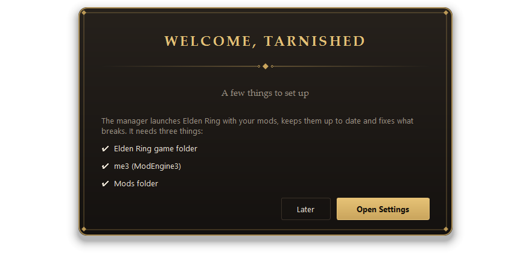

On the first start Roundtable checks three things: your **Elden Ring game folder**, **me3** (ModEngine 3 - the small program that actually loads mods into the game) and your **Mods folder**. Press **Open Settings** to fix whatever it flags.

- **me3:** choose **Tools → This program → Install or update me3...** and follow the installer like any other. When it closes, Roundtable finds it by itself. If a Microsoft Visual C++ runtime is missing, the same window offers to install it.
- **Mods folder:** an empty folder is fine - Roundtable fills it.

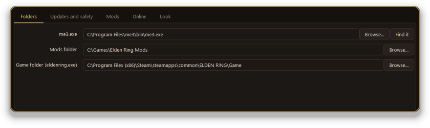

### 4. (Optional, but handy) Add your Nexus key

A free Nexus Mods account lets Roundtable search for mods, show their pictures, and check for updates. On nexusmods.com open your account's **API Keys** page, copy the **Personal API Key**, and paste it into **Settings → Online → Nexus API key**, then press **Test key**. The key stays on your PC, is stored encrypted, and is only ever sent to nexusmods.com.

Also on this tab: **Nexus download buttons** - turn it on and the *Mod Manager Download* button on a Nexus mod page sends the file straight to Roundtable. This works with free accounts.

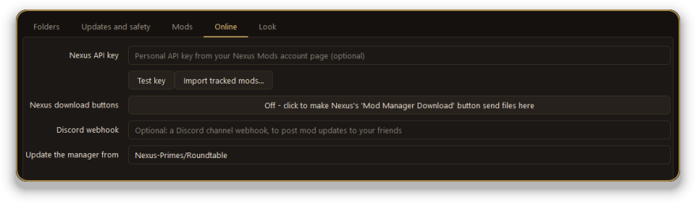

---

## Install a mod

Press **＋ Install a mod** (bottom left). There are two ways in:

- **Search Nexus Mods** - type a name, pick a result, and read its description, pictures and recent changes before you install. Buttons open its comments and bug reports on Nexus.
- **From a file or folder** - choose a `.zip`, `.7z` or `.rar` you already downloaded (`.7z` and `.rar` need [7-Zip](https://www.7-zip.org/) installed; Roundtable tells you if it can't find it). You can also just drag the file onto the window.

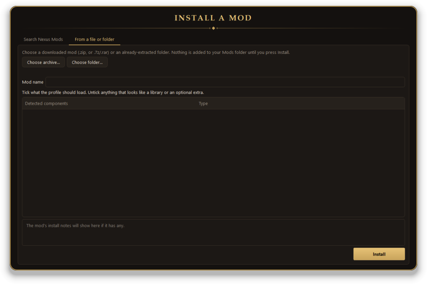

Roundtable unpacks the mod, shows what it found (DLL files and asset folders, and which to switch on), and installs it only when you press **Install**. Common profile mistakes are repaired as it goes, and the whole install can be undone.

**Add-ons:** small DLL mods (free camera, UI tweaks) are offered as an add-on to a mod you already play, instead of a separate mod.

### Some mods need one more step

If a mod's author says something must be run once before the first launch - an install `.bat`, a *Setup UI images* shortcut, a zip of DLLs meant for the game folder - Roundtable offers to do it right after the install. **Nothing runs until you press a button.** Each item opens in its own window, Roundtable waits for it to finish, checks that it succeeded, and lets you retry if it didn't.

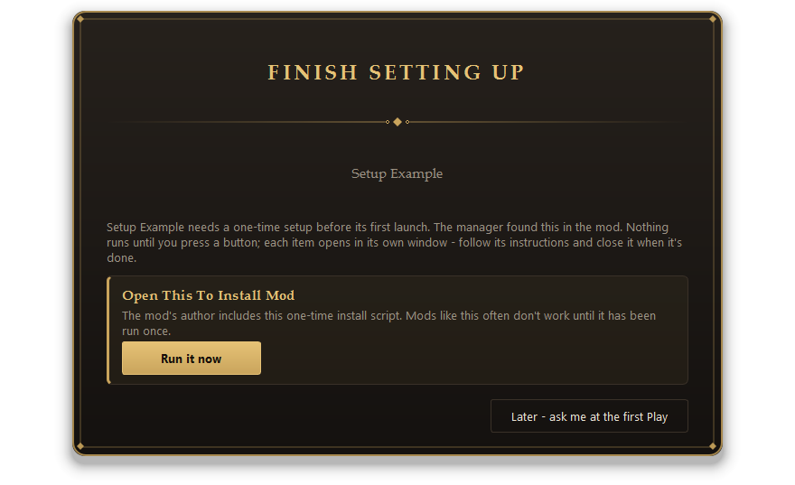

---

## A mod's page

Click a mod in the list on the left. The top shows its version, where it's published and whether it's ready. Under the **PLAY** button are four tabs.

**Overview** - the health check (*"All good - everything this mod points to is there"*), any setup steps, and what happened on the last launch.

**Components** - every DLL and asset folder the mod loads. Tick to switch one on, untick to switch it off; drag or use the arrows to change the load order; **Add DLL...** and **Add asset folder...** add your own; **Loadouts** saves named combinations you can switch between; **Check conflicts** finds two mods replacing the same files.

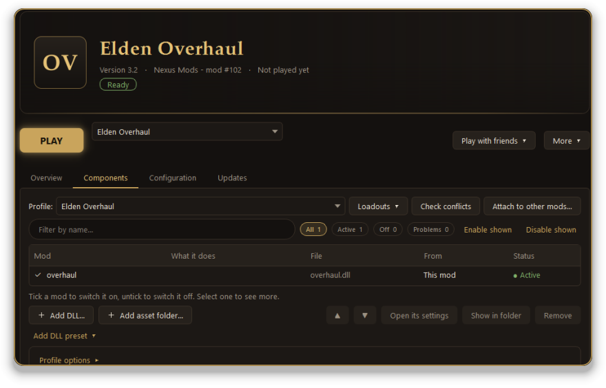

**Configuration** - the mod's settings files shown as a tidy form (or raw text), with *Revert*, *Save changes* and *Open in editor*. Edited files are backed up first, and the author's original is always kept.

**Updates** - covered [below](#keeping-up-to-date).

---

## Press PLAY

Pick the mod, pick a profile if it has several, and press **PLAY**. Before the game starts, Roundtable looks the profile over and, if something is likely to go wrong, tells you in plain words and lets you decide.

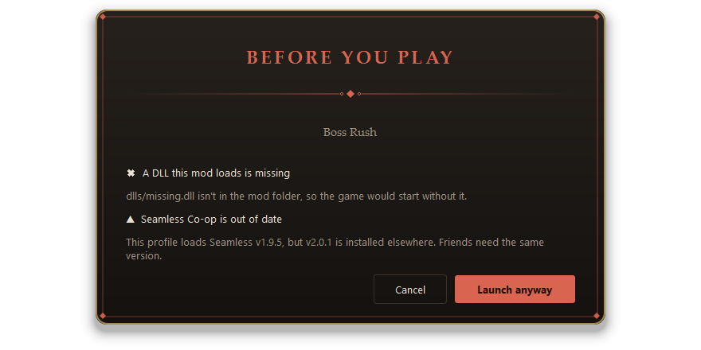

While the game runs, the button shows **RUNNING** (and blocks a second launch), and playtime is tracked per mod. Afterwards Roundtable reads the logs and tells you if your mod didn't load and why.

Vanilla Elden Ring starts through Steam with Easy Anti-Cheat. Mods start through me3. Modded **online** play can get an account banned - Roundtable never turns online mode on and warns you if a profile has it.

---

## When something goes wrong

Start with the buttons on the mod's **Overview** tab:

- **Why won't it start?** collects every clue (including files Windows Defender removed) and lists the likely cause first.
- **Doctor** checks your whole PC: game folder, me3, the Visual C++ runtime.
- **Fix problems...** scans the mod and offers repairs you tick one by one - re-linking moved files, copying in a missing shared DLL, switching off files that can't work. Everything is backed up and can be undone.

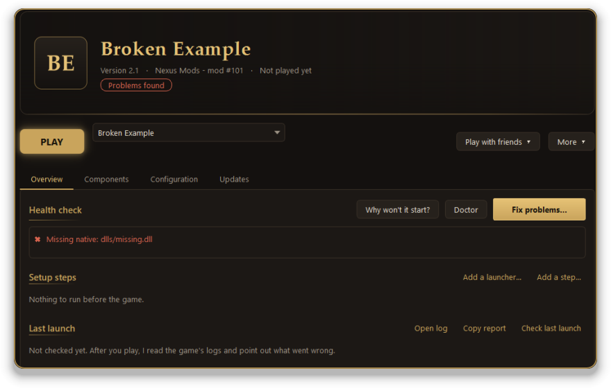

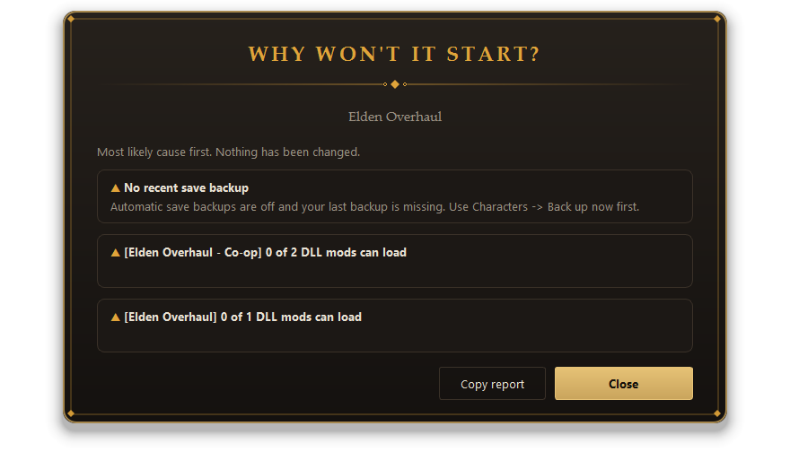

**The game crashes at start?** Roundtable reads Windows' own crash records and, if one DLL is to blame, offers to switch it off. If it can't tell, **Find the cause** switches half of a mod's DLLs and folders off, asks you whether it still crashes, and narrows it down to the one that matters.

**Needs and requirements:** the **What this mod needs** card on a known mod's Overview checks your PC - me3, the DLC, ray tracing, the game version - and puts a button next to anything missing. If you need to share a problem, **Copy report** gathers everything (personal paths removed).

---

## Packs built from other mods

Some packs, like **FRZN's Merge Modpack**, are made by layering several other mods you download yourself. After you install one, the **Install the dependencies** window opens (or press the button on the pack's *What this mod needs* card):

1. Press **Get it** on each mod. A Premium Nexus account downloads it for you; a free account opens that file's Nexus page and the *Mod Manager Download* button there hands the file back. Already downloaded it? Roundtable spots it in your Downloads folder.
2. When all are ready, press **Build it**. Each is unpacked and layered in the order the author's instructions give, with the right old version where needed (FRZN needs McKenyu's 1.3.11, not the newest).

If a build stops, press **Build it** again - finished steps are remembered.

---

## Play with friends

Co-op only works when **everyone has the same mod versions, the same Seamless Co-op version and the same password.** Roundtable makes that much less painful.

On a mod's page press **Play with friends**. A green checklist covers the Seamless version, a password, your own save file, me3 and the game version, and you can copy a ready-to-send **invite** or post it to Discord. **Compare setups** finds out exactly *why* two people can't connect.

- **Add Seamless Co-op...** (on the *Components* tab) puts Seamless into a mod with its own save file, so characters never get mixed up.
- **Share my setup / Install a friend's setup** (in *Tools*): a friend pastes your setup (or a link to it) and Roundtable fetches the same mod versions, adds your add-on DLLs, sets up Seamless and switches the same DLLs on in the same order. The password and settings files are only included if you tick them, and your friend sees a plain list of changes first and can undo them.

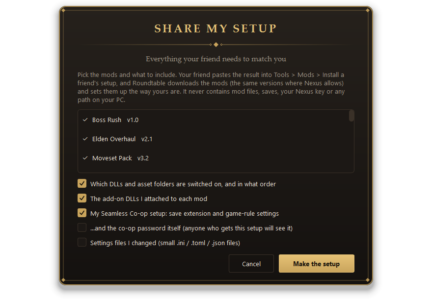

**All your passwords and save files in one place:** *Tools → Seamless Co-op → Passwords and save files...* lists every co-op setup on your PC. Change passwords and save-file endings (even set one password for everything), spot clashes, and let Roundtable give each mod its own. Changing an ending can copy your existing save across so your character comes with you.

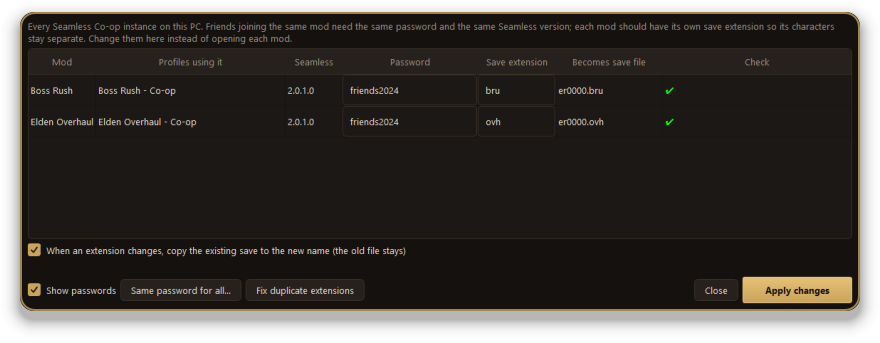

**Seamless versions:** Seamless refuses to start when its DLL is out of date. *Tools → Seamless Co-op → Seamless versions...* lists every copy on your PC and updates the older ones from the newest.

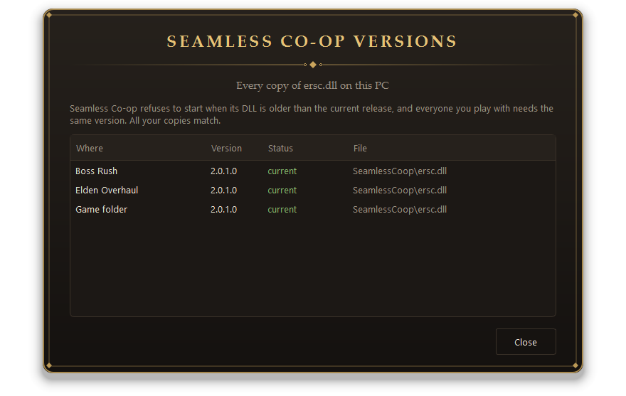

**DLL presets:** save the DLL mods you use everywhere as a preset (*Tools → Mods → DLL presets...*) and add it to any mod in one click. If a mod already has one of the same DLLs, Roundtable asks which copy to use, so nothing is loaded twice.

---

## Your saves

Click **Characters** in the list. You see every save file, which mod uses it, and the characters inside.

- **Backups happen automatically** before each launch and before anything that touches a save. Unchanged saves share space, so keeping many costs little. *Back up now* takes one on demand, and a second copy can go to another drive or a synced folder.
- **Copy a character** from one save to another (for example into your co-op save) with *Copy this character to another save...*. It only works between saves from the same Steam account, checks everything first and backs up first.
- **Deleting is guarded.** Deleting a character or a whole save makes a protected backup, shows exactly what will go, and makes you **type the name**. Deleted saves are moved aside, not erased, and *Restore* brings them back.

Please **play offline** with copied or edited characters - modded online play can get an account banned.

---

## Keeping up to date

**Mods.** Open a mod's **Updates** tab. Roundtable compares your version with the mod's Nexus or GitHub page; when a new one is out, a badge appears in the list and **Update to ...** downloads and applies it safely. **Undo last update** reverses it.

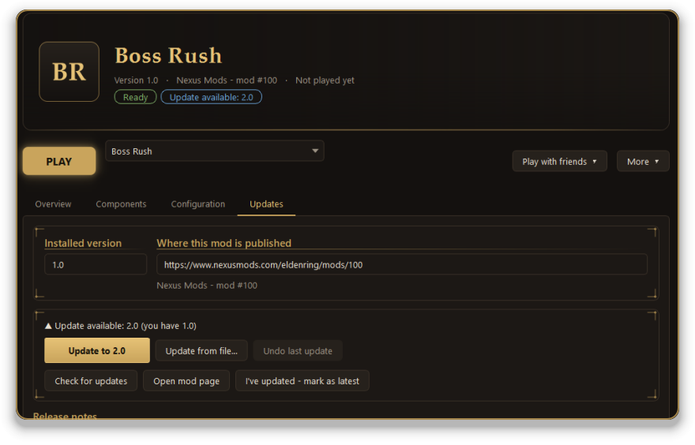

- **Patches are found and applied safely.** Some mods publish a small patch for the previous version as well as the full download. Roundtable tells them apart and offers the patch only when it was made for exactly the version you have.
- **The author's instructions are read.** If an update comes with a README that explains how to apply it, Roundtable shows those steps before changing anything.
- **Update from file...** applies a download you made yourself.

**me3:** Roundtable checks about once a day. *Tools → This program → Update me3...*.

**The manager itself:** when a new version is published, a banner appears in the sidebar. Click it and Roundtable downloads the update, checks its signature, restarts, and keeps all your settings and backups. If a new version ever misbehaves, *Tools → This program → Go back to an earlier version...* returns to the one you had.

**The game:** Roundtable remembers your `eldenring.exe` version. When a game patch changes it, you're told, offered an update check, and mods whose logs show they don't support the new version are marked.

---

## Finding things

Press **Ctrl+K** to jump to any mod or tool by typing a few letters. **F1** lists the keyboard shortcuts.

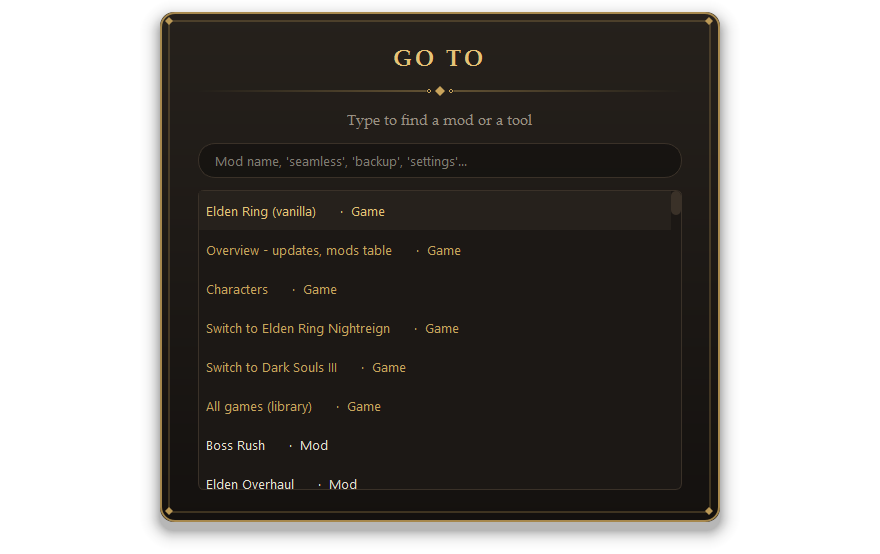

Everything else lives under the **Tools** button, grouped by topic. **All tools...** lists every tool, setting and appearance option on tabs, with a search box. Opening a window from another replaces it with a *Back* link, so only one is in front at a time.

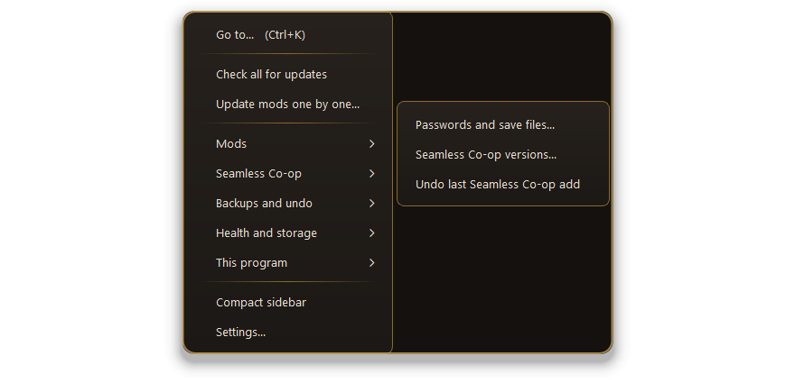

The sidebar has search and **All / ★ / Updates / Issues** filters, and the **Overview** page shows how all your mods are doing - counts, the updates waiting, and every mod as a sortable table or a card gallery. A bell in the footer keeps messages you missed.

---

## Tidying up

*Tools → Storage... → Choose downloads to delete...* lists every downloaded archive with why it can go: the mod is already installed, it's an older copy, or it was used to build a layered pack (kept unless you tick it, because a rebuild needs it again). Older copies are ticked for you, and **nothing is deleted until you confirm**. Installed mods are never touched.

In **Settings → Updates and safety** you can also keep only the newest few archives per mod and trim old backups automatically - both are off by default.

Deleted mods wait in *Tools → Deleted mods* until you restore them or remove them for good. **Back up manager setup...** zips your settings, links and profiles so you can move to a new PC.

---

## Make it yours

Open **Tools → This program → Appearance...** and pick a theme. Each is a complete colour scheme named after something from the Lands Between, and the whole manager changes straight away - **Cancel** puts everything back, **Save** keeps it.

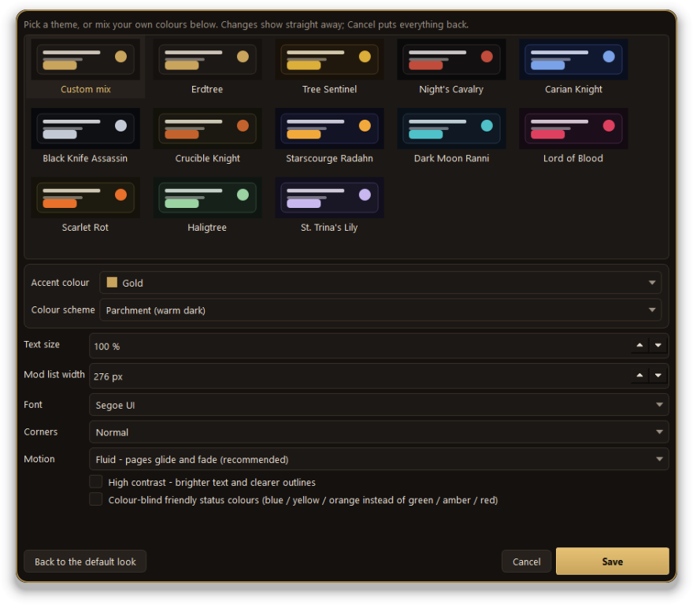

You can also change the **text size**, the **font**, how **rounded** the corners are, the **width of the mod list**, how much **animation** you want (Off, Calm, Fluid, Lavish), switch on **high contrast**, or use **colour-blind friendly status colours**.

---

## More games

The box at the top of the sidebar switches between **Elden Ring**, **Elden Ring Nightreign** and **Dark Souls III** - each keeps its own mods folder, profiles and save backups. *All games...* shows every supported game as a card; games you install through Steam are found by themselves. Dark Souls 1 and 2 are launched through Steam with save backups. **Bloodborne** (the community Windows port) gets Play, a health check, every launcher setting and a controller check - without touching the game files.

---

## Something went wrong?

<b>The game started but my mod isn't there / "ModEngine3 failed to load"</b>

 
1. Press <b>Why won't it start?</b> on the mod's page, or open <b>Tools → PC check (Doctor)</b>. They list what's wrong in plain words and have buttons for the common fixes. 
2. Press <b>Fix problems...</b> on the mod's page. 
3. Make sure the mod is <b>not</b> inside a OneDrive folder, and that Roundtable and your mods aren't inside the Elden Ring game folder. 
4. Still stuck? Press <b>Check last launch</b>, then <b>Copy report</b>, and send it to whoever is helping you.

<b>My friend can't join my game</b>

 
Use <b>Play with friends → Compare setups</b> on both PCs. It lists what differs - Seamless version, DLLs, settings, password. The most common cause is a different Seamless Co-op version or password.

<b>I changed a save-file ending and my character "disappeared"</b>

 
The character is still in the old save file. In <b>Passwords and save files...</b> tick <i>copy the existing save to the new name</i> when you change an ending - or use the <b>Characters</b> page to copy it across afterwards.

<b>Do I need Nexus Premium?</b>

 
No. Free accounts work: use the <i>Mod Manager Download</i> button on a mod page. Premium adds fully automatic downloads.

<b>Where does Roundtable keep my information? How do I uninstall it?</b>

 
Your settings, Nexus key and backups are in the <code>data</code> folder next to <code>Roundtable.exe</code>. Nothing is uploaded. To uninstall, close Roundtable and delete its folder - your mods and saves are not touched. (me3 can be removed from Windows' <i>Installed apps</i>.)

---

## Privacy and safety

- Your Nexus key and Discord webhook stay on your PC, stored **encrypted with Windows' own protection** (tied to your Windows account), and are only sent to nexusmods.com / discord.com.
- **Updates are signed.** Each release carries a signature; Roundtable has the matching public key built in and refuses an update whose signature doesn't check out.
- Roundtable contacts GitHub (its own updates and me3), Nexus Mods, Microsoft (only if you ask it to install the Visual C++ runtime) and - only if you set one up - your Discord webhook.
- Mods are always downloaded from the author's own page. This project never hosts or re-shares mod files.
- Nothing that touches your saves or mods is done without a backup, and the common ones can be undone from inside the app.

## Credits

An unofficial fan tool, not affiliated with FromSoftware, Bandai Namco, Nexus Mods, or the authors of me3 or Seamless Co-op - please support the mod authors whose work you install. Thanks to **me3 / ModEngine 3** (garyttierney), **Seamless Co-op** (LukeYui) and **ER-Save-Editor** (ClayAmore). *Elden Ring* is a trademark of FromSoftware / Bandai Namco. Third-party software is listed in `THIRD-PARTY-NOTICES.txt`.

**Found a bug or have an idea?** Open an [issue](https://github.com/Nexus-Primes/Roundtable/issues) and, if you can, paste the text from the *Copy report* button.
