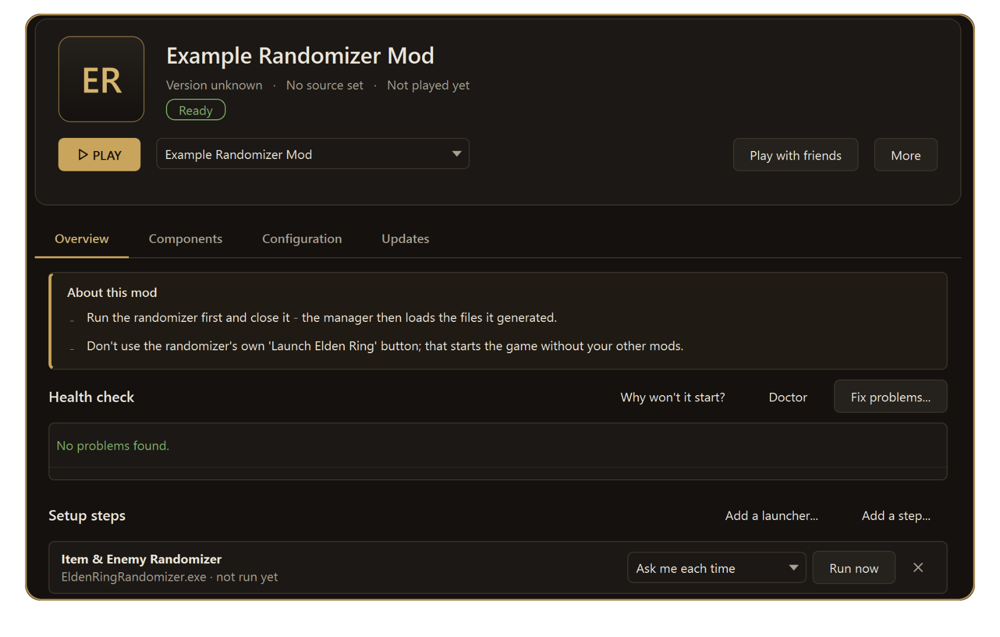
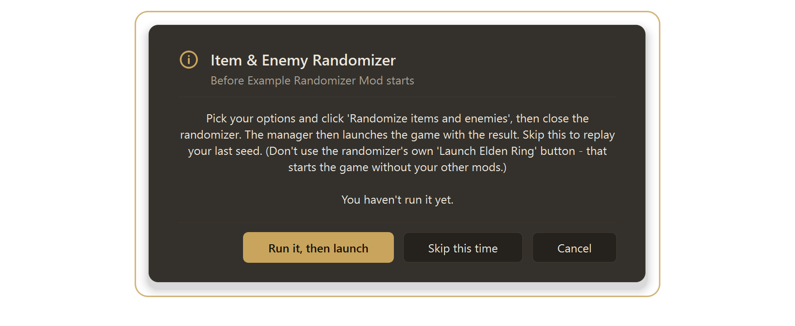
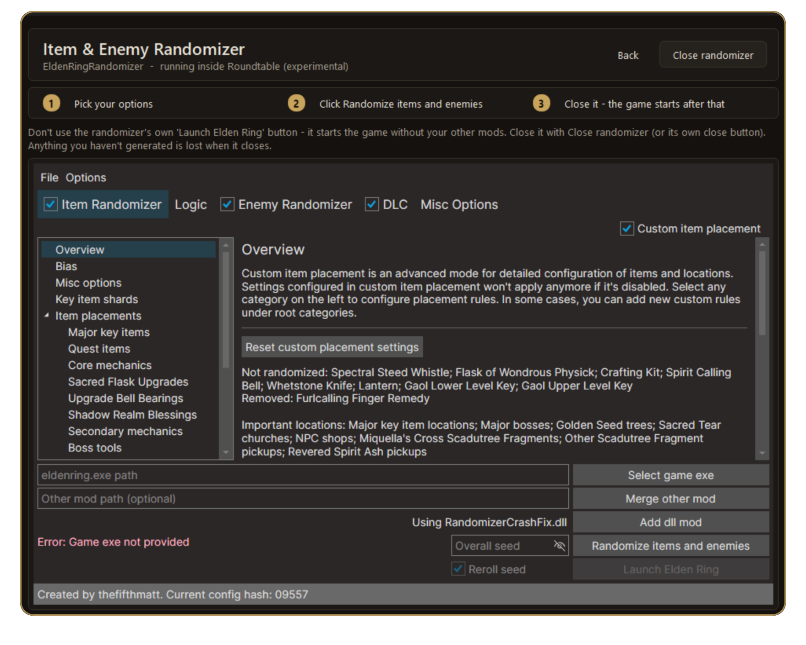
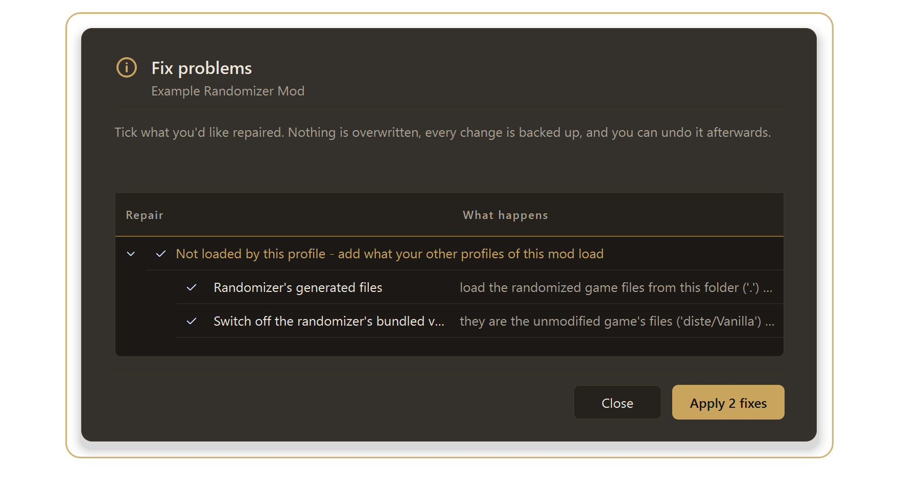

# The Item & Enemy Randomizer in Roundtable

[Back to the main page](../README.md)

The Item & Enemy Randomizer generates randomized game files, then you play them with your other mods. Roundtable runs it for you as a **setup step before the game starts**, loads the files it makes, and lets you use your DLL presets with it.

**What you get**

- The randomizer's window **on a page inside Roundtable** when you press PLAY.
- A **steps strip** (1 Pick your options, 2 Click Randomize items and enemies, 3 Close it - the game starts after that).
- The game starts **through me3 with your other mods and DLLs**, using the files your seed made.
- A one-click fix that makes sure the **right files are loaded** for your seed.

*The randomizer is added as a Setup step by itself. "Ask me each time" is the default; "Run now" runs it without pressing PLAY.*

---

## 1. Install it

1. Download the randomizer from its Nexus page and install it from **Install a mod** (or unpack it into your Mods folder).
2. Open the mod in Roundtable. On its **Overview** tab, **Setup steps** adds **Item & Enemy Randomizer** by itself (it recognises `EldenRingRandomizer.exe`). It is set to **ask each time**.

## 2. Play with a new seed

1. Press **PLAY**. Roundtable asks: **Run it, then launch**, **Skip this time**, or **Cancel**. The note shows what to do: pick your options and click *Randomize items and enemies*, then close the randomizer.

2. Choose **Run it, then launch**. The randomizer appears on a page inside Roundtable.

3. Set your options. The randomizer shows "Game exe not provided" until you tell it where `eldenring.exe` is (its **Select game exe** button).
4. Click **Randomize items and enemies**. Wait for it to finish.
5. Close it (the **Close randomizer** button, or its own close button). The game starts straight after, with your other mods.

> **Do not use the randomizer's own "Launch Elden Ring" button.** It starts the game with its own built-in mod loader and **without your other mods**. Close the randomizer and let Roundtable start the game.

## 3. Replay your last seed

Press **PLAY** and choose **Skip this time**. Nothing is regenerated; the files from your last run are loaded again.

Want it to run every time, or never ask? Change the step's setting on the mod's Overview (*Ask me each time / Run before every launch / Only when I click Run*).

## 4. Make sure your seed is what loads (Fix problems)

After a run, the randomizer's generated files (`regulation.bin`, `map`, `msg`, `event`, ...) sit in its own folder. A profile only uses them if that folder is one of its asset folders.

- After you close the randomizer, Roundtable offers the profile changes that make the game use them (**"Randomizer's generated files"**). Accept it, or press **Fix problems...** on the mod's page at any time.
- The same fix **switches off the randomizer's bundled vanilla files** (`diste/Vanilla`). They are the unmodified game's `regulation.bin` and text; if they are loaded they replace your seed. (The randomizer's own launcher never loads them.)
- Every fix is backed up and can be undone.

*The mod's health check can say "No problems found" and still offer these two: they aren't mistakes in the profile, they are what makes your seed load.*

## 5. Your DLLs

Your **DLL preset** works with the randomizer. Add it from the mod's **Components** tab (**Add DLL preset**). The DLLs are listed in the mod's profile, so they load when Roundtable starts the game.

You do **not** have to add them in the randomizer's own **Add dll mod** list. That list only matters for the randomizer's own *Launch Elden Ring* button, which you aren't using.

## 6. If it isn't randomized

1. Open the mod's page and press **Fix problems...**. Apply "Randomizer's generated files" and "Switch off the randomizer's bundled vanilla files" if they are offered.
2. Look at the newest log in `%LOCALAPPDATA%\garyttierney\me3\data\logs\Elden_Ring_Item_and_Enemy_Randomizer\`. Lines starting `override=` show which folder each game file came from. If `regulation.bin` comes from `diste\Vanilla`, the fix in step 4 hasn't been applied.
3. Check that you played with the profile Roundtable started (the Play list's first entry), not another launcher.

## Good to know

- **Where it opens.** The randomizer is shown inside Roundtable only when Windows' display scaling is 100%; otherwise (or if you switch it off in *Settings → Show the Item & Enemy Randomizer inside Roundtable*) it opens in its own window and PLAY waits for you to close it, exactly as before.
- **Back** on the page returns to the mod and leaves the randomizer running. Closing Roundtable asks first if the randomizer is still open.
- **The randomizer's own look** (its tabs, sliders, buttons) is drawn by the randomizer and can't be restyled by Roundtable.
- **Spoiler logs** are written by the randomizer into its `spoiler_logs` folder.
- Play **offline**; modded online play can get an account banned.

## What was and wasn't tested

Tested end to end on a real setup: the randomizer drawn inside Roundtable, clicking and typing in it, the hand-over to the game, and the game starting with a randomized seed. **Not tested:** display scaling above 100%.

[Back to the main page](../README.md) · [Convergence](CONVERGENCE.md) · [Save editor](SAVE-EDITOR.md) · [Smithbox](SMITHBOX.md)
