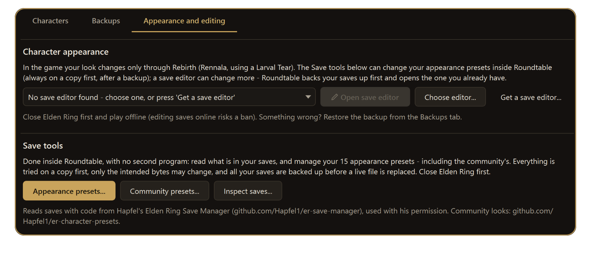
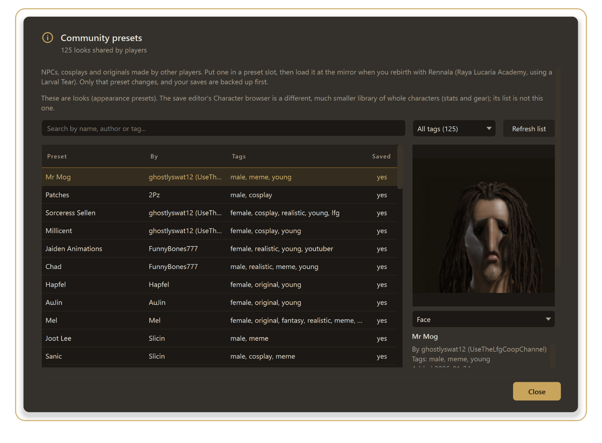

# The save editor and your characters in Roundtable

[Back to the main page](../README.md)

Roundtable looks after your saves (backups, copies, restores) and works with a **save editor** for the things only an editor can change. It also has its **own tools for your 15 appearance presets** and for reading what is in a save, with no second program.

> **Credit.** The save editor and the save-reading code come from **[Hapfel's Elden Ring Save Manager](https://github.com/Hapfel1/er-save-manager)** ("Elden Ring Save Manager" on Nexus), used with Hapfel's permission. Roundtable reads saves with a small part of his code, unchanged and with his licence. **His editor program is not part of Roundtable** - you download it separately (below). The community appearance looks come from his [er-character-presets](https://github.com/Hapfel1/er-character-presets) library (MIT).

**What you get**

- **Open save editor**: backs your saves up first, then opens the editor - inside Roundtable or on its own.
- **Appearance presets**: your 15 mirror presets with their pictures, which you can copy, edit, import, export and delete, and **take the pictures from the game** in one click.
- **Community presets**: about 125 looks other players shared, to browse and put into a slot.
- **Inspect saves**: every character with its level, stats and anything wrong, read-only.
- Safety around all of it: a copy is tried first, only the bytes of the one thing you changed may differ, and every save is backed up before a real file is replaced.



---

## 1. Get the editor

On **Characters → Appearance and editing**:

- **Get a save editor...** opens the tool list, where Hapfel's *Elden Ring Save Manager* can be installed from Nexus or GitHub into your **My tools** list (it is not bundled).
- **Choose editor...** points Roundtable at a save editor you already have.

## 2. Use the editor

1. **Close Elden Ring** and play **offline** (editing saves online risks a ban).
2. On **Characters → Appearance and editing**, press **Open save editor**.
3. Roundtable first **backs up your saves**, then opens the editor. If display scaling is 100%, it appears **on a page inside Roundtable** with *Back to Characters*, *Open in its own window* and *Close editor* at the top.
4. Make your changes **and save them in the editor**. Anything you haven't saved there is lost when it closes.
5. Press **Close editor** (or the editor's own close button).

Good to know:

- The editor **keeps running** if you go to another page. Roundtable won't start the game from its Play buttons while it is open (the game and the editor would both write your save).
- Closing Roundtable asks first if the editor is still open.
- Something wrong afterwards? **Characters → Backups → Restore** puts a backup back (what is there now is backed up first).
- If the editor can't be shown inside Roundtable (display scaling above 100%, or you switched *Settings → Show the save editor inside Roundtable* off), it opens in its own window as before.

## 3. Your 15 appearance presets

On **Characters → Appearance and editing**, press **Appearance presets...**. The list shows each preset's body, face, hair and age, its colours as swatches, and a **picture** of the look. The buttons work on the selected preset:

| Button | What it does |
|---|---|
| **Copy to another preset...** / **Copy to another save...** | Duplicate a look inside a save or into another save of the same Steam account. |
| **Edit values...** | Change any value, grouped by body, face, hair, eyes, makeup and so on (colours as swatches). |
| **Export...** / **Import...** | Save a look to a file, or put one from a file into a slot. |
| **Delete** | Empty a slot (backed up first). |
| **Add picture...** / **Remove picture** | Attach your own picture to a look. |
| **Grab from the game...** | Take all 15 pictures from the game's own screen (below). |
| **Community presets...** | Browse and import shared looks. |

Pictures belong to the **look itself** (a fingerprint of its values), not to a slot, so a picture follows the preset when you copy or move it, and a different look in the same slot doesn't wear it.

### Grab the pictures from the game

1. Start Elden Ring, go to the mirror, open **Load Favorite** (the page that shows your 15 portraits).
2. In Roundtable press **Grab from the game...**. It brings the game's window forward, looks at the screen, and cuts out the 15 portraits.
3. A sheet shows what it found. Press **Keep these pictures**.

Notes:

- The portrait the cursor is on has a golden glow in the game; it is **dimmed and left out** (a glowing picture would be wrong). Move the cursor in the game and grab again to get it.
- It only accepts a **16:9** game window, visible and not covered. It never sends the game a key or a click.
- Close the game afterwards before you edit presets (Roundtable asks you to close Elden Ring first).

## 4. Community presets



*The looks and their pictures come from Hapfel's er-character-presets library (MIT).*

**Community presets...** lists looks shared by other players - NPC lookalikes, cosplays and originals - with search and pictures. You can download them all to use offline, and put one into a preset slot. The preset is tried on a copy first, and your save is backed up before the real file changes.

## 5. Inspect saves

**Inspect saves...** lists every save with its characters, level, stats and health, including characters you deleted in the game. It is read-only; every save is read from a copy.

## 6. From the command line

```
Roundtable-cli.exe save-check "C:\path\to\ER0000.sl2"
Roundtable-cli.exe save-check --json "C:\path\to\ER0000.sl2"
```

Reports whether the save is readable and lists its characters and presets. The exit code is 0 when it is fine and 1 when problems were found.

## If something goes wrong

- *"Hapfel's er-save-manager source isn't set up"*: the save-reading code could not be found; choose its folder in the window that appears, or download Hapfel's editor with **Get a save editor...**.
- A preset looks wrong after editing: restore a backup from **Characters → Backups**.
- **Close Elden Ring first** for anything that changes a save.

## What was and wasn't tested

Tested: reading real saves on copies, the preset tools, the pictures (including grabbing from the live game), and the editor on a page inside Roundtable. **Not tested:** in-game results of every community look, and display scaling above 100%.

[Back to the main page](../README.md) · [Convergence](CONVERGENCE.md) · [Randomizer](RANDOMIZER.md) · [Smithbox](SMITHBOX.md)
