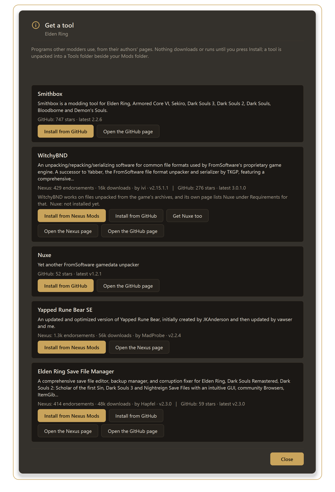

# Smithbox in Roundtable

[Back to the main page](../README.md)

[Smithbox](https://github.com/vawser/Smithbox) is a modding tool for FromSoftware games (params, maps, text, models and more). Roundtable installs it, opens it **with a project for your mod already made**, and can show it **on a page inside the manager**.

**What you get**

- **Install Smithbox from inside Roundtable** (from its own GitHub page), with update checks.
- **Open in Smithbox (project ready)**: from a mod's page, Roundtable makes the Smithbox project for that mod and starts Smithbox.
- Smithbox **on a page of Roundtable's own** (*Back to Overview*, *Open in its own window* and *Close Smithbox* at the top).

---

## 1. Install it

1. Open **Tools → Mods → My tools**, choose **Add a tool...** and **Get a known tool (Nexus / GitHub)...**.
2. Press **Install from GitHub** next to **Smithbox**. Roundtable downloads the newest release, unpacks it into a `Tools` folder next to your Mods folder, finds the program and adds it to **My tools**. Nothing is run.
3. Roundtable looks at the tool again when you press **Check for updates** and offers **Update...** when there is a newer one (the old copy is kept as `.previous`).

Already have Smithbox? Use **I already have the program** and choose it.

## 2. Open it on a mod, project ready

1. Open the mod's page, press **More**, then **Open in Smithbox (project ready)...** (shown when Smithbox is installed from the tool list and the game is one Smithbox supports).
2. If the mod has more than one folder of game files, you pick which. If there is no Smithbox project for it yet, Roundtable asks first, because it **adds one small file** to Smithbox's folder (delete that file to remove the project). The project points at the mod's game files and the game's folder.
3. Smithbox starts. **Pick the project in its list.**

## 3. Open it on its own (from My tools)

**Tools → Mods → My tools**, choose Smithbox and open it. It runs from its own folder. This is also how you open it for anything that isn't a particular mod.

## 4. Smithbox inside Roundtable

By default, Smithbox opens on a page of Roundtable's own instead of a separate window.

- **Open in its own window** hands the window back to the desktop at any time; nothing you have open in it is lost.
- **Close Smithbox** asks first - anything you haven't saved in Smithbox is lost when it closes. Closing Roundtable asks too.
- It keeps running if you go to another page.
- Only used at **Windows display scaling of 100%**; otherwise it opens in its own window.
- Turn it off in **Settings → Show Smithbox inside Roundtable (very experimental)**.

**Limits, honestly:** Smithbox draws with your graphics card (OpenGL), which is why this is marked *very experimental*.

- **The mouse works** (menus, windows and tabs respond).
- **Typing may not.** In testing, text boxes (for example the preferences search box) did not take typed letters when Smithbox was inside Roundtable. If keys do nothing, press **Open in its own window** and use Smithbox there, or switch the setting off so it always opens separately.
- Pictures can flicker or look wrong on some graphics drivers; the same remedy applies.

## 5. Other tools that work the same way

**Nuxe** and **Yapped Rune Bear SE** (and Yapped for Dark Souls III) open on a page of Roundtable in the same way (*Settings → Show Nuxe and Yapped inside Roundtable*, on by default). **WitchyBND** is not shown inside Roundtable; it has its own window: on a mod's **More** menu, **Unpack or repack with WitchyBND...** runs it on copies of your files and shows what it made before anything goes into the mod.

## If something goes wrong

- **A tool shows a ".NET must be installed" message** (Nuxe did on one PC): install the .NET runtime it names from Microsoft and try again.
- **Nothing happens when you press Open in Smithbox:** make sure Smithbox was installed from the tool list (My tools shows it).
- **It opens in its own window:** your display scaling isn't 100%, or the Settings option is off. That is fine.

## What was and wasn't tested

Tested: installing it, the project file, Smithbox drawn inside Roundtable (menus, windows and tabs respond to the mouse), and the hand-back to its own window. **Not tested:** typing in Smithbox inside Roundtable (it did not work in my tests), and display scaling above 100%.

[Back to the main page](../README.md) · [Convergence](CONVERGENCE.md) · [Randomizer](RANDOMIZER.md) · [Save editor](SAVE-EDITOR.md)
